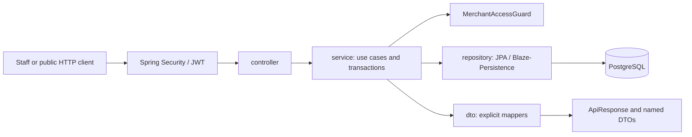

# Architecture snapshot

Reviewed: 2026-10-07 (Asia/Jakarta). Memory version: 8. Initial discovery evidence below retained; delegated feature update included.
Evidence: current working-tree source, pom.xml, AGENTS.md, PRD-MVP.md, and Codebase Memory graph. This is a structural review, not runtime or security certification.

## Application structure

Entity package update, 2026-10-08 (memory15): shared/catalog owns ProductEntity, CategoryEntity, OptionGroupEntity, ProductOptionEntity and CashierCatalogItemEntity. Shared/sales additionally owns CashierSaleEntity, CashierSaleItemEntity and PickupDeliveryJobEntity. F&B retains order lifecycle, order snapshots, payment/discount/gateway, table and QR models; laundry retains service/pricing and laundry-order models. Package/import refactor only; schemas and separate existing catalog/sales models remain unchanged. Evidence: reports/ENTITY-20261008-orchestrator.md.

One Java 17 / Spring Boot 4.1.1 backend: a modular monolith organized in existing top-level packages under `org.lite.project.cashiersaas`.



Controllers adapt HTTP and return `ApiResponse<T>`; services coordinate transactions, guards, persistence and explicit DTO mappers. Entities own named business transitions. Repositories use EntityManager and Blaze-Persistence; QueryDSL generated Q types support typed paths. `ApiResponse` omits null fields. Current exception classes reside in `exception/runtime`, with `GlobalExceptionHandler`; AGENTS.md instead prescribes `shared/exception/runtime` for the policy boundary. Do not silently move existing code during discovery.

## Functional boundaries

- Identity and sessions: RegisterService, LoginService, AuthSessionService, JwtTokenService, JWT configuration and conversion. Account scope supports onboarding and merchant selection; merchant scope carries tenant/outlet/membership context. Refresh tokens are persisted as digests and rotated; sessions support revocation. Stateless HTTP security does not mean refresh sessions have no database state.
- Merchant foundation: tenant, outlet, tenant membership, membership outlet access, invitations, onboarding and subscription/free-tier services.
- Owner business settings: MerchantBusinessSettingsController/Service/Repository/Mapper update existing tenant/outlet fields with owner guard and tenant lock. Currency changes are blocked after any tenant order/sale; tax/service changes apply to future orders. Conditional before/after audit commits atomically. Logo is a validated HTTPS URL; upload/storage is outside this slice.
- Owner audit viewer: MerchantAuditController/Service/Repository/Mapper expose read-only tenant/outlet-scoped, filtered and paginated projections. Count and rows share predicates; outlet-local dates are bounded; null-outlet records and sensitive identity fields are excluded.
- F&B catalog and QR: FnbCatalogService, FnbTableService, FnbOrderQrService, PublicQrAccessService. Public QR resolves tenant/outlet and optional table from validated server-side token context.
- Shared F&B checkout: PublicOrderService and FnbPosOrderService use FnbOrderPricingService and SalesOrderEntity with line/option snapshots. Both sources feed the same operational order model.
- Operations: FnbStaffOrderService, FnbDiscountService, FnbOrderCancellationService, FnbPaymentService, MockFnbGatewayService, FnbKitchenService and FnbTableReconciliationService.
- Receipts and reports: FnbReceiptService and FnbSalesReportService/FnbSalesReportRepository. Paid-sales queries scope both payment and order to tenant/outlet, use payment time, require PAID and exclude CANCELLED.
- Separate earlier cashier sales/catalog services and broader laundry/inventory/platform entity/schema areas remain present. Their existence does not establish active MVP acceptance or completed features.

## Security and tenancy

SecurityConfiguration owns stateless HTTP policy, BCrypt and CORS. JwtConfiguration wires HS256 signing/verification, mandatory environment secret, issuer/audience/time and required claims checks. TenantJwtAuthenticationConverter distinguishes ACCOUNT and MERCHANT scopes. Merchant conversion requires UUID subject, session, tenant, outlet and membership claims plus supported roles.

Active role policy is exactly SUPERADMIN, OWNERMERCHANT and CASHIER. Platform routes require SUPERADMIN; merchant routes OWNERMERCHANT; cashier routes OWNERMERCHANT or CASHIER. Account-only routes use SCOPE_ACCOUNT. Public QR routes are anonymous and use token-scoped context.

MerchantAccessGuard checks principal outlet and reloads authorized membership/outlet access through MerchantAccessRepository. Failed ownership/access checks use ResourceNotFoundException to avoid disclosing another tenant's records. Protected data context comes from the principal, public context from validated QR. This review sampled boundaries; exhaustive tenant-isolation proof remains pending.

## Pay First state and consistency

```text
QR/POS checkout -> NEW + UNPAID
successful settlement -> CONFIRMED + PAID
kitchen -> PREPARING -> READY -> COMPLETED
NEW + UNPAID -> CANCELLED (reason and audit in service)
```

SalesOrderEntity enforces these transitions. Discount and cancellation require NEW/UNPAID. Pricing uses BigDecimal, server-side availability/pricing and order snapshots. Checkout requires an idempotency key and stores a request fingerprint; changed-request key reuse conflicts. Payment supports replay/conflict checks and a separate mock gateway attempt model. Payment settlement records payment, audit and table reconciliation inside the service transaction.

FnbOrderRepository locks the tenant row with PESSIMISTIC_WRITE. Checkout/payment/kitchen use this coordination; it serializes mutations for a tenant and is a potential throughput bottleneck. Entity uniqueness includes tenant/idempotency and outlet/order-number. Runtime concurrency and actual database constraint enforcement were not tested.

## Persistence and delivery limits

- PostgreSQL, Hibernate schema validation, open-in-view disabled. Flyway is enabled for runtime migration. Liquibase runtime is disabled; optional schema-diff Maven profile is diagnostic tooling.
- Working tree has deletions of historical V1-V10 migrations and an untracked `V1__initial_schema.sql` containing a broad schema. Older docs report an unresolved authentic V11 conflict. Current database history was not inspected; migration/deployment readiness is unknown.
- Existing graph contains 186 Java files and 10 SQL files; it does not contain current FnbPaymentService/FnbKitchenService classes. Use graph as navigation only, verify against source and refresh before relying on current call coverage.
- Native WebSocket is now implemented in TASK-032. Owner/Cashier obtains a single-use ticket through scoped Bearer HTTP; handshake receives the ticket through Sec-WebSocket-Protocol, never a URL. Ticket TTL is capped at 30 seconds and JWT expiry; connection lifetime uses JWT expiry separately. Current session/membership/outlet authorization is revalidated on access and periodically. Allowed origins, ticket/session bounds and shutdown cleanup are explicit.
- F&B mutation services publish immutable minimal invalidation snapshots; a TransactionalEventListener dispatches only AFTER_COMMIT through a bounded asynchronous executor. QR/POS checkout, settlement/mock outcomes, discount/cancellation and kitchen transitions have hooks; idempotent replays do not emit. Clients resync through REST. Delivery is single-JVM best effort, with no replay/distributed broker; overload drops require polling fallback. Source-reviewed only: container/compile/runtime acceptance pending.
- PRD describes additional Manager/Kitchen roles and pay-after-meal flows; explicit active repository policy takes precedence for this snapshot: three roles and Pay First. Reconciliation of product documentation is pending, not a newly approved product decision.
- No frontend package.json/tsx/vue/html files were found by repository file search. This snapshot covers backend architecture.

## Ruflo evidence

Swarm `swarm-1791361273309-rota2f` initialized with hierarchical topology, specialized strategy, maximum 3 agents. Memory search returned no prior architecture entries; keyword routing recommended security-architect. Registered Sonnet reviewers: `agent-1791361308449-h63kyb` (security) and `agent-1791361308340-gxo7t6` (operations).

Actual agent_execute attempts failed: no LLM provider configured (ANTHROPIC_API_KEY / OPENROUTER_API_KEY / OLLAMA_API_KEY absent from Ruflo provider configuration). Registration is not executed review evidence. This snapshot was reviewed by the orchestrator using source and graph, not produced by those workers. No provider configuration, application code, SQL or tests changed. No builds, tests, startup or database commands ran.

### Verified alternative execution

Authenticated Codex CLI execution succeeded without adding provider API keys. The tested arrangement is Ruflo coordination plus separate Codex execution, not a native agent_execute provider integration. Claude Code is not required.

Initial read-only Codex workers could not invoke file-reading commands under the environment policy. The orchestrator supplied bounded, labelled source bundles over stdin instead; reviewers used no tools and had no independent filesystem access. Both subsequent reviews completed with exit code 0:

- Security: thread `01a11593-6548-7a41-ba9f-9ad9c62549b3`; report `reports/RUFLO-ARCH-SECURITY.md`.
- F&B: thread `01a11594-d925-7790-9ac3-c0b406c43b61`; report `reports/RUFLO-ARCH-FNB.md`.

Task contracts, input bundles and dirty-tree baseline are retained in `tasks/TASK-RUFLO-ARCH-*.md` and `reports/RUFLO-ARCH-*`. Worker memory baseline was 2. Orchestrator reviewed reports against source before advancing memory to 3.

Reviewed qualifications: operational membership guards currently require FREETIER subscriptions. Guards do not visibly consult session revocation or bind their query to the JWT membership_id; immediate revocation of already-issued access JWTs is not established. These are review questions, not proven externally reachable defects. Checkout replay additionally depends on currently valid QR/table context; kitchen transition retries are not idempotent. Reports count paid transactions without requiring completion; product metrics are line totals and do not allocate order discounts/tax/service charges. Full call-site/security, database and runtime acceptance remain pending.

### Delegated implementation evidence

TASK-030/031/032 subsequently executed using authenticated Codex CLI workers with independent contexts and disjoint reserved writes; Ruflo swarm/registrations coordinated only. All three implementations and worker corrections were reviewed against current source and the dirty-tree baseline. No worker allowlist violations were found. Reports and actual thread IDs: `reports/MVP-20261007-orchestrator.md`. The orchestrator authored coordination/canonical documents, not application code. No SQL, tests, builds, startup or database operations ran. General HTTP guard review questions above remain; the new WebSocket access service explicitly validates live sessions, selected merchant scope and membership binding.
