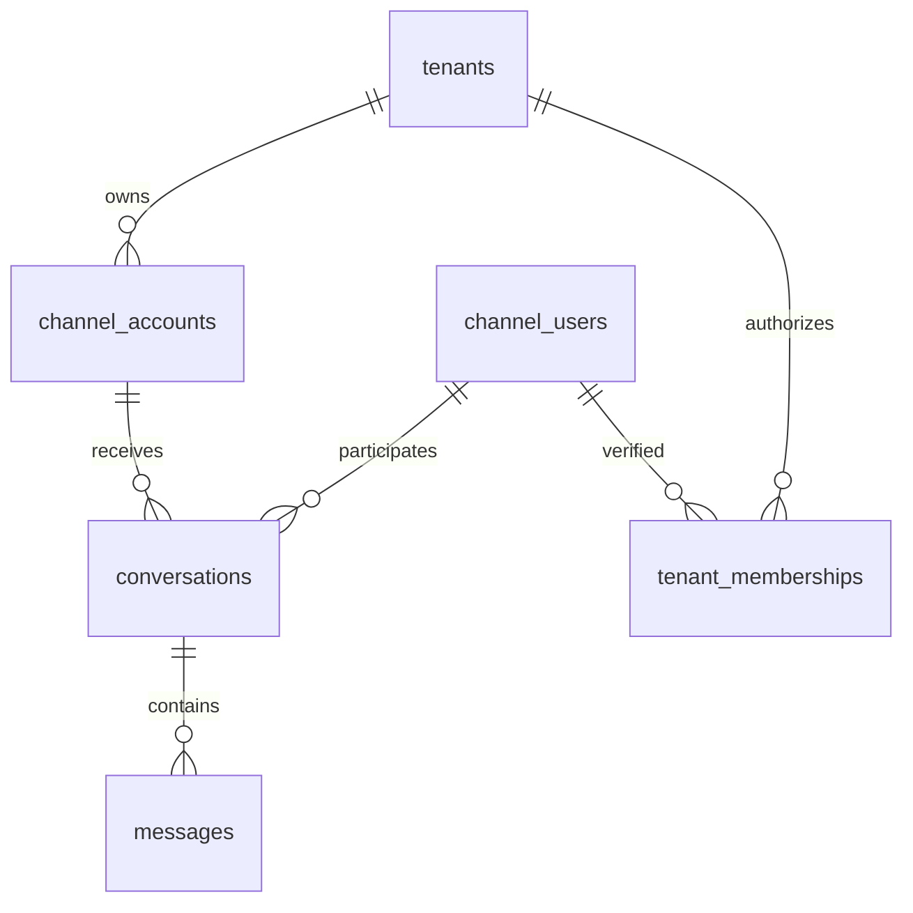

# Schema minimal AI Services

Keputusan 13 Oktober 2026: identitas Telegram dan WhatsApp dipisahkan. Database kosong sehingga schema awal diganti. Ketahanan antrean ditunda sesuai pilihan pengguna. Schema sekarang **6 tabel, 31 kolom**.

| Tabel / Entity | Kolom | Jumlah |
| --- | --- | ---: |
| `tenants` / `Tenant` | `id`, `created_at` | 2 |
| `channel_accounts` / `ChannelAccount` | `id`, `tenant_id`, `platform`, `external_account_id`, `username` | 5 |
| `channel_users` / `ChannelUser` | `id`, `platform`, `external_user_id`, `username`, `first_name`, `created_at` | 6 |
| `conversations` / `Conversation` | `id`, `channel_id`, `platform`, `user_id`, `external_chat_id`, `status`, `created_at`, `last_message_at` | 8 |
| `messages` / `Message` | `id`, `conversation_id`, `external_message_id`, `role`, `content`, `created_at` | 6 |
| `tenant_memberships` / `TenantMembership` | `tenant_id`, `user_id`, `role`, `verified_at` | 4 |

Entity SQLAlchemy: [entities.py](../app/chat/entities.py). Query: [repositories.py](../app/chat/repositories.py). Transaksi/use case: [service.py](../app/chat/service.py). Migrasi awal [0001_channels.py](../migrations/versions/0001_channels.py) adalah snapshot eksplisit, bukan pembuatan tabel saat startup.

## Identitas dan batas tenant

Platform `TELEGRAM` dan `WHATSAPP` memiliki identitas terpisah. Account unik berdasarkan `(platform, external_account_id)` dan pengguna berdasarkan `(platform, external_user_id)`. Semua external ID berupa string. Nama/username boleh berubah atau kosong; tidak ada penggabungan akun otomatis.

Tenant percakapan diperoleh melalui `channel_accounts.tenant_id`; kepemilikan pesan melalui conversation. Repository membatasi tenant/channel/platform/pengguna/chat pada operasi percakapan, pesan dan history. Foreign key komposit memastikan account dan pengguna percakapan berasal dari platform yang sama. Profil pengguna global dalam platform.

Startup Telegram memakai UUID `AI_TENANT_ID` dari konfigurasi server dan ID bot dari `get_me`. Account yang sudah dimiliki tenant lain tidak dipindahkan. Registry tenant AI tidak memberikan akses otomatis ke data Cashier.

Membership memiliki primary key `(tenant_id,user_id)`, role `OWNERMERCHANT` atau `CASHIER`, serta `verified_at` wajib tanpa default. Pesan pelanggan tidak membuat membership. Verifikasi/provisioning belum memiliki API pada perubahan ini. `SUPERADMIN` tetap role global sistem Cashier.

## Percakapan dan pesan

ID utama berupa UUID, kecuali `messages.id` memakai BIGINT identity. Timestamp memakai TIMESTAMPTZ. Status sesi `ACTIVE` atau `CLOSED`; partial unique index menjaga satu sesi aktif per channel/platform/pengguna/chat. `last_message_at` boleh NULL sebelum ada pesan.

Partial unique index `(conversation_id, external_message_id)` berlaku jika external ID tidak NULL. USER menyimpan ID pesan provider; ASSISTANT menggunakan NULL sehingga beberapa jawaban dapat disimpan. Lookup duplikat TEXT memeriksa semua sesi untuk pengguna/chat/channel yang sama.

Kolom summary, token_count, model/provider, reply_to, sequence dan status delivery ditunda. History mengikuti BIGINT `messages.id` dengan indeks `(conversation_id,id)`.

## Alur dan batasnya

Intake Telegram memvalidasi private human/allowlist, memanggil ChatService secara serial, lalu mengirim jawaban. ChatService menyimpan USER dan membaca history dalam transaksi singkat, memanggil AI di luar transaksi, lalu menyimpan ASSISTANT sebelum pengiriman. History memakai pasangan USER/ASSISTANT tersimpan; keberhasilan delivery tidak dicatat. Command/error tidak menjadi history AI.

`/start` menyapa, `/session` menampilkan sesi sendiri, `/new` menutup sesi lama dan membuka sesi baru tanpa menghapus history. Command tidak dideduplikasi persisten; pengulangan `/new` bisa membuat sesi lagi.

Tidak ada inbox/outbox atau worker antrean. Retry hanya selama proses hidup. Restart setelah USER disimpan bisa meninggalkan pertanyaan tanpa jawaban; restart setelah ASSISTANT disimpan bisa meninggalkan jawaban belum terkirim. Duplikat TEXT tersimpan dilewati tanpa regenerasi/resend. Recovery antrean/pengiriman ditunda.

Schema mendukung WhatsApp; webhook/sender WhatsApp belum diimplementasikan. Transport saat ini Telegram long polling dengan advisory lock bot pada satu database AI.

## Setup dan verifikasi

Gunakan database AI kosong/fresh untuk revision `0001_channels`. Snapshot baru bukan upgrade dari `0001_telegram`; database yang memakai revision lama memerlukan rencana migrasi tersendiri. Pekerjaan ini tidak menjalankan reset, migrasi, startup, database atau API nyata.

Model dan snapshot migrasi cocok pada pemeriksaan metadata offline: 6 tabel, 31 kolom, 6 foreign key dan 3 indeks eksplisit. Source serta kode unit test disesuaikan. **READY FOR TESTING**, tes belum dijalankan. Bukti dan skenario berikutnya: [review](progress/channels-orchestrator-review.md).
