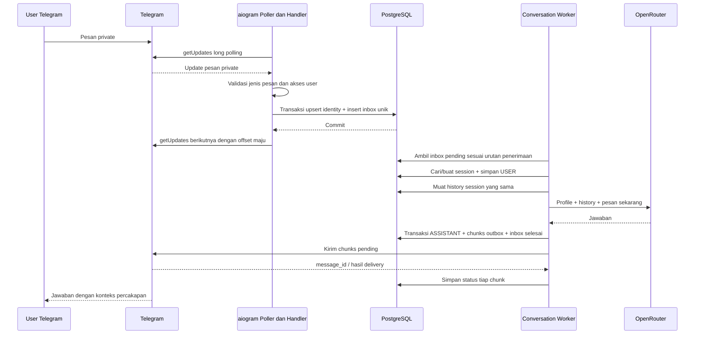

# Rancangan Telegram, identitas user, dan conversation session

> Dokumen historis sebelum perubahan schema. Keputusan terbaru memakai 6 tabel/31 kolom tanpa inbox/outbox atau worker antrean. Lihat [schema aktif](channel-schema.md) dan [README](../README.md).

Tanggal: 13 Oktober 2026, Asia/Jakarta. Rancangan implementasi aiogram long polling.
Kode kini tersedia; status dan bukti review ada di
[catatan review](progress/telegram-orchestrator-review.md). Database belum dimigrasikan
dan runtime belum diverifikasi. Bagian kondisi source merekam baseline sebelum perubahan.

## 1. Kondisi source yang diperiksa

- `app/channels/telegram/bot.py` menjalankan aiogram long polling. Startup justru
  menolak bot dengan webhook aktif. Belum ada route HTTP webhook Telegram.
- `app/config.py` memuat konfigurasi Telegram dan OpenRouter dalam satu Settings.
- `app/openrouter.py` menerima satu teks; payload hanya system prompt dan pesan
  terakhir. Tidak memuat riwayat, profil user, atau session percakapan.
- `app/application.py` membuat client OpenRouter dan memulai polling melalui lifespan.
- `pyproject.toml` belum mempunyai dependency persistence PostgreSQL.
- Direktori `app/ai` dan `app/chat` tersedia tetapi belum berisi source aktif.
- Catatan canonical parent masih menggambarkan source lama yang lebih kompleks;
  desain ini mengikuti source saat ini. Git status tidak dapat diperoleh karena
  Git gagal mengakses path root parent; tidak ada klaim working tree bersih.

## 2. Batas rancangan dan asumsi

Tahap pertama melayani pesan teks private dari manusia, tetap menggunakan allowlist
opsional. Grup, media, dan pesan edit tidak diproses sebagai percakapan baru.
Semua command melewati pemeriksaan identitas dan akses yang sama.
Identitas Telegram belum membuktikan kepemilikan akun Cashier atau hak tenant.
Tidak ada akses data kasir sebelum mekanisme pengaitan akun yang terverifikasi.

PostgreSQL memakai database AI tersendiri, dikelola AI Service. Tabel Cashier tidak
diubah. Untuk bot tahap awal, satu bot memiliki satu service scope dari konfigurasi
server. Bot ke scope dipetakan server-side; teks user tidak dapat memilih scope.
Satu scope demo tidak boleh dianggap sebagai tenant bisnis yang terautentikasi.
Jika nanti satu bot melayani banyak merchant, kontrak pengaitan akun harus dirancang
sebelum membuka akses bisnis.

## 3. Struktur direktori yang dituju

```text
app/
  application.py                   # wiring, lifespan, routes
  config.py                        # komposisi settings dan pemuatan .env sekali
  ai/
    __init__.py
    config.py                      # OpenRouterSettings
    openrouter.py                  # client provider dan AIError
    prompts.py                     # system instruction dan profil tampilan
  channels/telegram/
    bot.py                         # Bot, Dispatcher, polling, lifecycle
    config.py                      # TelegramSettings
    handlers.py                    # handler teks/command dan intake persisten
    sender.py                      # pengiriman chunk dan status delivery
  chat/
    identity_service.py            # upsert profil berdasarkan Telegram ID
    session_service.py             # session aktif, /new, /start, /session
    conversation_service.py        # urutan pemrosesan dan konstruksi history
    repositories.py                # query yang selalu dibatasi scope/identity
    models.py                      # model persistence
    worker.py                      # pemroses inbox dan outbox PostgreSQL
  core/
    database.py                    # engine/session async PostgreSQL
migrations/                        # migrasi AI Service sendiri
```

Pemindahan meliputi field `openrouter_key` dan `ai_model` ke OpenRouterSettings,
serta client `app/openrouter.py` ke `app/ai/openrouter.py`. Application dan handler
menggunakan import baru. Settings global menyusun settings AI, Telegram, dan DB.
Nama `OPENROUTER_API_KEY` serta `AI_MODEL` tetap berlaku; kredensial tetap berada
di environment/.env, bukan di source `app/ai`. Ini pemindahan tanggung jawab kode.

Konfigurasi tambahan: `DATABASE_URL` dan service scope server-side.
Tidak diperlukan URL webhook, secret webhook, endpoint publik, atau tunnel HTTPS.
Gunakan SQLAlchemy async, asyncpg, dan Alembic saat implementasi. Tidak perlu
Redis, LangGraph, atau queue eksternal untuk acceptance path pertama.

## 4. Identitas user dan nama

Ambil profil dari `message.from_user` pada objek aiogram Message: `id`, `username`,
`first_name`, `last_name`, `is_bot`, dan bahasa jika tersedia. `message.chat.id`
menjadi alamat pengiriman. `update_id` berasal dari Update yang diberikan dispatcher,
bukan dari Message.
Telegram mendokumentasikan ID user sebagai pengenal unik dan username sebagai
field opsional: [Telegram User](https://core.telegram.org/bots/api#user).

- Kunci identitas: `(service_scope_id, bot_id, telegram_user_id)`.
- `username` bukan primary key dan tidak digunakan untuk otorisasi.
- Display name: gabungan first name/last name; fallback username, lalu label user.
- Update profil setiap pesan diterima, termasuk mengosongkan username jika hilang.
- ID user/chat disimpan BIGINT; ID internal aplikasi memakai UUID.
- Dua user dengan nama sama tetap memiliki profil dan riwayat berbeda.

AI dapat menyapa nama yang tersimpan. Profil masuk sebagai data terstruktur dalam
konteks, bukan instruksi system yang digabungkan langsung dari nama user. Nama,
username, dan isi chat tidak memberi hak akses atau mengubah aturan AI.

## 5. Model data PostgreSQL

| Tabel | Isi utama | Constraint penting |
| --- | --- | --- |
| `telegram_identities` | UUID, scope, bot ID, Telegram user ID, username, first/last/display name, created/updated/last seen | UNIQUE(scope, bot, Telegram user ID) |
| `conversation_sessions` | UUID, scope, identity ID, chat ID, status ACTIVE/CLOSED, last sequence, created/last activity/closed at | Satu ACTIVE per (scope, bot, identity, chat); partial unique index |
| `conversation_messages` | UUID, scope, session ID, sequence, role USER/ASSISTANT, content, inbound update ID, reply-to ID, model, provider response ID, timestamps | UNIQUE(session, sequence); satu USER per update dan satu ASSISTANT per reply-to USER |
| `telegram_inbox` | UUID, scope, bot ID, update ID, identity, chat ID, message ID, urutan penerimaan, jenis command/text, normalized content, status, attempts, next attempt, error code | UNIQUE(scope, bot, update ID) |
| `telegram_outbox` | UUID, scope, session/inbox reference, assistant message reference opsional, chunk number, text, status, Telegram sent message ID, retry data | UNIQUE(inbox, jenis respons, chunk number) |

Semua foreign key antar tabel memeriksa scope yang sama, bukan hanya UUID.
Index history pada `(scope, session_id, sequence)`; index pending job pada
`(status, next_attempt_at)`. Waktu disimpan UTC/timestamptz.
Outbox juga menyimpan salam, hasil command, dan error; tidak semua outbox menunjuk
pesan ASSISTANT. Status turn provider disimpan pada inbox.
Jangan menyimpan bot token, API key, atau payload mentah penuh.
Konten chat diperlukan untuk history tetapi tidak ditulis ke log aplikasi.
Retensi history perlu keputusan operasional sebelum produksi; /new menutup session,
bukan menghapus data. Penghapusan data adalah fungsi terpisah dari reset konteks.

## 6. Flow end to end



Pertahankan `Dispatcher.start_polling(..., handle_as_tasks=False)` agar handler
intake ditunggu secara serial. Handler memvalidasi dan menyimpan identity/inbox;
OpenRouter dipanggil worker terpisah. Update yang tidak didukung atau tidak diizinkan
diabaikan. Update duplikat menyelesaikan intake tanpa job baru.

Telegram mengonfirmasi update saat getUpdates memakai offset lebih tinggi:
[getUpdates](https://core.telegram.org/bots/api#getupdates). Identity dan inbox wajib
commit sebelum handler selesai. Saat DB sementara tidak tersedia, intake melakukan
retry dengan backoff yang dapat dibatalkan saat shutdown; jangan melanjutkan batch
atau polling berikutnya sebelum commit.
Jangan hanya melempar exception DB dan menganggap Telegram akan mengulang pesan:
dispatcher aiogram menangani exception pemrosesan dan polling dapat melanjutkan
offset. Retry persistence berada dalam intake; kegagalan tak terduga yang mengancam
persistence menghentikan poller melalui supervisor lifecycle.
Rujukan: [aiogram Dispatcher](https://docs.aiogram.dev/en/latest/_modules/aiogram/dispatcher/dispatcher.html).

Inbox adalah antrean persisten; worker membuat USER sekali saja. Constraint DB
menangani update yang diterima ulang setelah restart. Telegram menyimpan update
belum diterima maksimal 24 jam; outage panjang sebelum intake commit tetap dapat
kehilangan update. Durabilitas berlaku setelah pesan masuk database.

Gunakan satu proses, satu poller, dan satu worker pada tahap awal, tanpa reload atau
beberapa Uvicorn worker. Startup memeriksa DB dan bot, serta tetap menolak webhook
aktif. Jangan menghapus webhook atau pending updates otomatis. FastAPI tetap
mengelola health dan lifecycle. Shutdown menghentikan intake, memberi waktu terbatas
bagi worker, kemudian menutup bot, HTTP client, dan engine DB; job tersimpan yang
belum selesai dilanjutkan pada startup berikutnya.

## 7. Kontrol session dan urutan

- Pesan pertama membuat session ACTIVE secara atomik.
- Pesan berikutnya memakai session yang sama, termasuk setelah restart server.
- `/start` menyapa display name dan memakai/membuat session aktif tanpa reset history.
- `/new` menutup session aktif dan membuat session baru; history lama tetap tersimpan.
- `/session` menampilkan referensi session dan nama user, tanpa data user lain.
- Tidak ada expiry otomatis pada tahap pertama agar percakapan tidak hilang mendadak.

Session ditentukan server dari scope/bot/identity/chat, bukan dari teks atau session
ID yang dikirim user. Constraint session aktif menangani race pembuatan session.
Satu worker memproses inbox sesuai urutan penerimaan, termasuk command /new,
sehingga respons pesan lama diselesaikan sebelum reset berikutnya. Pemrosesan AI
masih serial untuk semua user pada tahap awal; session setiap user tetap terisolasi.
Konsekuensinya, respons AI lambat dapat menunda user berikutnya.

Transaksi DB dibuat singkat dan tidak ditahan selama panggilan AI. Pada restart
tanpa proses lama yang masih berjalan, pulihkan inbox PROCESSING yang belum memiliki
jawaban tersimpan sebagai error aman: provider mungkin sudah menerima permintaan,
sehingga tidak dilakukan regenerasi otomatis. Jika jawaban/outbox sudah ada,
lanjutkan delivery saja. Identitas/session/history tetap tersedia setelah restart.
Paralelisasi per user dan lease/fencing baru ditambahkan bila throughput memerlukan.

## 8. History dan kegagalan

ConversationService memilih pasangan USER/ASSISTANT selesai dari session aktif,
mengurutkan sequence, lalu menambahkan USER saat ini tepat sekali. Riwayat penuh
disimpan; history ke provider dibatasi anggaran konteks model. Buang pasangan tertua
lebih dahulu, sisakan system instruction, profil seperlunya, dan pesan sekarang.
Tetap gunakan batas input 4000 karakter, output 1024 token dan timeout 45 detik
sebagai baseline. Pemanggilan memakai array `messages`:
[OpenRouter API](https://openrouter.ai/docs/api_reference/overview).

- Kegagalan provider disimpan sebagai status turn/error code; pesan aman dikirim
  melalui outbox, tidak dicampurkan sebagai jawaban model ke history sukses.
- Retry hanya kegagalan sementara dengan batas attempts dan backoff; 401/402/403
  tidak diulang otomatis. Timeout ambigu dapat menyebabkan biaya provider berulang;
  tidak ada klaim exactly-once terhadap provider.
- Jawaban disimpan bersama outbox sebelum dikirim. Restart pengirim menggunakan
  outbox yang ada, tidak memanggil model lagi jika jawaban sudah tersimpan.
- Status chunk: PENDING, SENDING, SENT, FAILED, UNKNOWN. Respons sukses menyimpan
  Telegram message ID. 429 dijadwalkan mengikuti retry_after. Timeout/crash setelah
  send dapat berarti terkirim tetapi acknowledgment hilang; tandai UNKNOWN dan
  jangan kirim ulang otomatis. Telegram sendMessage tidak memberi jaminan
  exactly-once, sehingga delivery ambigu perlu penanganan operasional.
- Urutan per session tetap menunggu delivery selesai atau terminal/UNKNOWN sebelum
  turn berikutnya diproses. Chunk sukses tidak diulang.
- Health readiness memeriksa DB dan kondisi worker; liveness tetap ringan.

## 9. Urutan implementasi dan acceptance

1. Pindahkan konfigurasi/client OpenRouter ke app/ai, perbarui semua import.
2. Tambahkan persistence serta migrasi identity/session/message/inbox/outbox.
3. Hubungkan polling yang ada ke penyimpanan identity dan ConversationService.
4. Hubungkan handler intake serial ke inbox persisten dan satu worker yang dikelola
   lifespan. Tidak ada tahap migrasi ke webhook.
5. Implementasikan command session, history budget, recovery, dan sender outbox.

Acceptance yang harus diverifikasi setelah implementasi selesai:

- Nama tampil benar dengan/tanpa username; perubahan username tidak membuat user baru.
- Dua user, termasuk nama sama, tidak pernah membaca history satu sama lain.
- Pertanyaan lanjutan menggunakan history session aktif; restart tetap melanjutkan.
- /new membuat session baru dan tidak memasukkan history lama ke prompt baru.
- Update duplikat tidak membuat pesan/session/job ganda.
- Dua pesan berdekatan dan /new diproses sesuai urutan yang disimpan.
- Allowlist berlaku untuk teks, /start, dan command lain.
- DB gagal tidak membuat intake selesai atau polling melanjutkan offset; retry dan
  pembatalan shutdown diperiksa menggunakan perilaku dispatcher yang sebenarnya.
- Hanya satu poller berjalan; webhook aktif tetap menyebabkan startup ditolak.
- Job tersimpan yang belum selesai pulih setelah restart.
- Provider gagal dan delivery ambigu mempunyai status yang dapat ditelusuri.
- Tidak ada token/secret atau isi chat penuh pada log.

## 10. Aturan coding Python untuk implementasi

- Utamakan keterbacaan, kesederhanaan, dan kemudahan pemeliharaan. Hindari one-liner
  cerdik atau sintaks ringkas yang menyulitkan pembacaan.
- Gunakan nama variabel, fungsi, dan class yang deskriptif serta type hint untuk
  parameter dan return value.
- Pilih if/for/while sederhana ketika lebih jelas daripada comprehension atau
  ekspresi kompleks. Gunakan early return untuk mengurangi nesting.
- Hindari fungsi bersarang dalam, lambda tanpa manfaat jelas, decorator yang tidak
  diperlukan, metaclass, dan teknik dinamis. Decorator framework tetap diperbolehkan.
- Gunakan class biasa jika sesuai; jangan memaksakan pola Java, interface, factory,
  base service, atau helper yang tidak dibutuhkan ke Python.
- Fungsi kecil memiliki satu tanggung jawab. Handler berupa method/fungsi bernama
  yang menerima dependency secara eksplisit, bukan closure besar di startup.
- Alur async, pembuatan task, cancellation, shutdown, dan penutupan resource harus
  terlihat jelas. Exception ditangani dengan tipe spesifik pada batas yang sesuai.
- async/await, async context manager, dan task background diperlukan agar polling,
  worker, dan HTTP tidak saling memblokir; sintaks lanjutan lain perlu alasan singkat.
- Mulai dari satu worker serial dan PostgreSQL; hindari abstraksi concurrency sebelum
  ada kebutuhan nyata. Pisahkan file hanya untuk tanggung jawab yang benar-benar ada.

Belum menjalankan unit/API/integration test, aplikasi, provider, atau database.
Pengujian dilakukan setelah implementasi end to end dan permintaan testing eksplisit.

## 11. Pemetaan implementasi

OpenRouterSettings/client berada di `app/ai`. Konfigurasi Telegram berada di
`app/channels/telegram/config.py`. Settings global menyusun konfigurasi tersebut
dan konfigurasi PostgreSQL; variabel baru adalah DATABASE_URL dan TELEGRAM_SERVICE_SCOPE.
Handler intake berada di `handlers.py`, operasi persistence memakai SQLAlchemy Core
di `repositories.py`, dan kontrol session/history/provider/outbox memakai satu
`worker.py`. Tidak dibuat model ORM atau service terpisah yang belum dibutuhkan.
Skema lima tabel berada di migrasi Alembic `0001_telegram.py`.

Koneksi PostgreSQL khusus memegang advisory lock untuk satu bot. Semua deployment
bot harus memakai database AI yang sama agar lock berlaku. Kehilangan koneksi pemilik
menghentikan channel dan memerlukan restart. `/ready` memeriksa DB dan task; `/health`
tetap menjadi liveness HTTP. Pengiriman SENDING yang terputus menjadi UNKNOWN, dan
chunk selanjutnya tidak dikirim otomatis. History provider memakai pasangan yang
sudah selesai dikirim, dengan anggaran prompt konservatif yang dijelaskan README.
