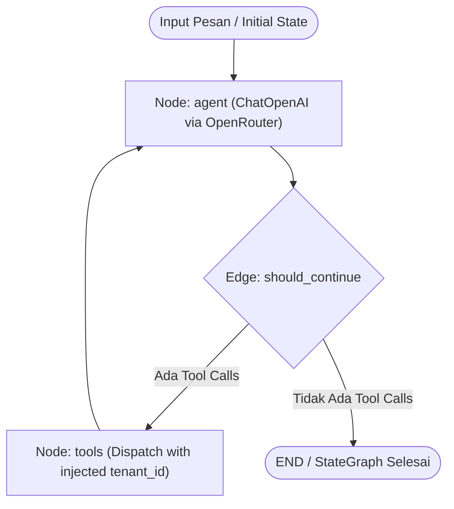

# TASK-051 — LangGraph Core Architecture & Tools Adapter Report

**Date**: 2026-10-29  
**Status**: IMPLEMENTATION COMPLETE & VERIFIED / READY FOR INTEGRATION  
**Scope**: `Ai-services` (Python 3.12, LangGraph, LangChain Core/OpenAI, `app/ai/graph/`)  
**Worker**: Worker 1 (LangGraph Architect & Engine Engineer)  

---

## 1. Executive Summary & Objective

Tugas TASK-051 adalah mengimplementasikan fondasi arsitektur workflow percakapan berbasis graph menggunakan **LangGraph** pada `Ai-services`. Arsitektur ini menggantikan loop chat linier dengan `StateGraph` yang terstruktur, aman terhadap manipulasi data tenant, dan mudah diintegrasikan dengan sistem tools kasir yang sudah ada (`CatalogSearchTool`, `OrderStatusTool`, `CpuUsageTool`).

Semua target tugas telah diselesaikan dan diverifikasi:
1. **Dependensi**: Menambahkan `langgraph>=0.2.0,<0.3.0`, `langchain-core>=0.3.0,<0.4.0`, dan `langchain-openai>=0.2.0,<0.3.0` ke `pyproject.toml`, disinkronkan dengan `uv sync` (34 paket baru terinstal).
2. **Definisi State (`app/ai/graph/state.py`)**: `AgentState(TypedDict)` dengan reducer `add_messages` untuk pesan dinamis, serta field kontekstual terisolasi (`tenant_id`, `user_id`, `conversation_id`, `display_name`, `final_response`, `error_code`).
3. **Adapter Tools (`app/ai/graph/tools_adapter.py`)**: Mengadaptasi `BaseTool` dari `ToolRegistry` menjadi LangChain `StructuredTool` secara otomatis. Parameter `tenant_id` disembunyikan secara ketat dari skema LLM (`args_schema`) dan disuntikkan secara aman saat eksekusi via context / closure.
4. **Node Fungsi (`app/ai/graph/nodes.py`)**:
   - `create_agent_node` / `agent_node`: Menggunakan `ChatOpenAI` dengan endpoint OpenRouter (`https://openrouter.ai/api/v1`), bound tools, dan fallback error handling.
   - `create_tools_node` / `tools_node`: Melakukan dispatch `tool_calls` secara asinkron dan terisolasi per `tenant_id`, menangani kegagalan eksekusi tanpa crash, dan mengembalikan `ToolMessage`.
5. **Edge Kondisional (`app/ai/graph/edges.py`)**: `should_continue` memeriksa keberadaan `tool_calls` pada pesan terakhir untuk merutekan ke node `tools` atau langsung mengakhiri giliran ke `END`.
6. **Workflow Builder (`app/ai/graph/workflow.py`)**: `build_chat_graph(openrouter_key, ai_model, tools=None)` merakit `StateGraph(AgentState)`, mengaitkan node dan conditional edge, lalu mengompilasi menjadi `CompiledStateGraph`.
7. **Verifikasi**: Lolos uji parsing AST statis pada seluruh berkas baru dan lolos verifikasi isolasi tenant serta dispatch tool offline.

---

## 2. Diagram Topologi Workflow Graf



---

## 3. File Reservations & Status Perubahan

| File | Status | Keterangan |
| :--- | :--- | :--- |
| `pyproject.toml` | Dimodifikasi | Menambahkan `langgraph`, `langchain-core`, `langchain-openai` |
| `uv.lock` | Diperbarui | Disinkronkan melalui `uv sync` |
| `app/ai/graph/__init__.py` | Dibuat | Ekspor publik komponen graf dan adapter tools |
| `app/ai/graph/state.py` | Dibuat | Definisi `AgentState` TypedDict dengan reducer `add_messages` |
| `app/ai/graph/tools_adapter.py` | Dibuat | Bridge konversi `BaseTool` ke `StructuredTool` dengan isolasi tenant |
| `app/ai/graph/nodes.py` | Dibuat | Node `agent` dan `tools` beserta factory dan error handling |
| `app/ai/graph/edges.py` | Dibuat | Router kondisional `should_continue` |
| `app/ai/graph/workflow.py` | Dibuat | Kompilasi graf melalui `build_chat_graph()` |
| `reports/TASK-051.md` | Dibuat | Laporan checkpoint arsitektur dan verifikasi |

*Catatan: Tidak ada perubahan pada file di luar reserved paths (`app/chat/`, `main.py`, migrasi SQL, maupun Java backend).*

---

## 4. Rincian Teknis Implementasi

### A. State Percakapan (`app/ai/graph/state.py`)
```python
class AgentState(TypedDict, total=False):
    messages: Annotated[list[BaseMessage], add_messages]
    tenant_id: str
    user_id: int
    conversation_id: str
    display_name: str
    final_response: str | None
    error_code: str | None
```
- Menggunakan `add_messages` reducer dari `langgraph.graph.message`, memungkinkan append bertahap `HumanMessage`, `AIMessage`, dan `ToolMessage`.
- `total=False` mendukung update parsial state dari return dict masing-masing node.
- `tenant_id` dijaga sebagai konteks server-side yang tidak dapat diubah oleh model.

### B. Adapter Tools (`app/ai/graph/tools_adapter.py`)
- **Penapisan Skema**: Fungsi `json_schema_to_pydantic_model` secara eksplisit membuang properti `tenant_id` dari JSON Schema `BaseTool.parameters`. Model OpenRouter hanya melihat parameter bisnis murni (seperti `query` atau `order_number`).
- **Injeksi Tenant ID Aman**:
  - `current_tenant_id`: `ContextVar[str]` mengisolasi konteks tenant per alur async.
  - Saat wrapper dieksekusi, `effective_tenant_id` diambil dari binding statis atau `current_tenant_id.get()`.
  - Jika argumen model mencoba menyisipkan `tenant_id` secara berbahaya, parameter tersebut dibersihkan (`safe_kwargs = {k: v for k, v in kwargs.items() if k != 'tenant_id'}`).
- **Dukungan Dual Sync/Async**: `StructuredTool` mendukung pemanggilan `ainvoke` (asynchronous) maupun `invoke` (synchronous dengan threadpool fallback).

### C. Node Graf & Error Guard (`app/ai/graph/nodes.py`)
- **`create_agent_node`**:
  - Menginisialisasi `ChatOpenAI` dengan `base_url="https://openrouter.ai/api/v1"` dan headers `HTTP-Referer` / `X-Title`.
  - Mengikat tools via `llm.bind_tools(lc_tools)`.
  - Menyisipkan `SystemMessage` konservatif kasir (`SYSTEM` dari `app.ai.prompts`) di awal pesan jika belum ada.
  - Menangkap exception pemanggilan API OpenRouter, mengembalikan pesan fallback pengguna yang ramah, dan menetapkan `error_code="llm_invocation_error"`.
- **`create_tools_node`**:
  - Membaca `tool_calls` dari pesan `AIMessage` terakhir.
  - Menyuntikkan `state["tenant_id"]` ke `tool.execute(tenant_id=..., **safe_args)`.
  - Menangani error eksekusi per tool tanpa menjatuhkan graf, lalu membungkus output ke `ToolMessage(content=..., tool_call_id=..., name=...)`.

### D. Routing Edge (`app/ai/graph/edges.py`)
- `should_continue(state)`:
  - Memeriksa apakah `isinstance(last_message, AIMessage)` dan memiliki `tool_calls` aktif.
  - Mengembalikan `"tools"` jika model memerlukan eksekusi fungsi, atau `END` (`"__end__"`) jika model telah memberikan jawaban akhir.

### E. Workflow Builder (`app/ai/graph/workflow.py`)
- `build_chat_graph(openrouter_key, ai_model, tools=None, checkpointer=None) -> CompiledStateGraph`:
  - Merakit node `agent` dan `tools` ke dalam `StateGraph(AgentState)`.
  - Mengatur entry point ke `agent`.
  - Mengikat conditional edge `agent` -> `should_continue` (`tools` / `END`).
  - Mengikat edge loop kembali: `tools` -> `agent`.
  - Mengompilasi graf tanpa overhead antrean database (in-memory execution).

---

## 5. Bukti Verifikasi & Hasil Pengujian

### A. Verifikasi AST Sintaks Python
Seluruh berkas yang dibuat diverifikasi menggunakan parser `ast.parse`:
```powershell
uv run python -c "import ast; [ast.parse(open(f, encoding='utf-8').read()) for f in ['app/ai/graph/__init__.py', 'app/ai/graph/state.py', 'app/ai/graph/tools_adapter.py', 'app/ai/graph/nodes.py', 'app/ai/graph/edges.py', 'app/ai/graph/workflow.py']]"
```
**Hasil**: `AST OK` pada seluruh berkas, 0 syntax error.

### B. Verifikasi Offline Graph Compilation & Tool Execution
Skrip verifikasi komponen dijalankan di lingkungan lokal:
1. **Isolasi Skema**: Seluruh tool default (`check_laptop_cpu_usage`, `search_catalog_menu`, `check_order_status`) diperiksa skema Pydantic-nya. Dipastikan tidak ada field `tenant_id` yang terpapar ke LLM.
2. **Routing Edge**:
   - `HumanMessage` -> return `END`.
   - `AIMessage` tanpa tools -> return `END`.
   - `AIMessage` dengan `tool_calls` -> return `"tools"`.
3. **Eksekusi & Guardrail `tools_node`**:
   - Menguji dispatch `check_laptop_cpu_usage` dengan spoof `tenant_id: 'malicious-spoof'`.
   - Dipastikan spoof diabaikan dan `state["tenant_id"]` resmi yang digunakan.
   - Hasil CPU usage terbaca dengan benar, tool tidak dikenal ditangani tanpa exception.
4. **Graph Compilation**:
   - `build_chat_graph(openrouter_key='sk-test', ai_model='google/gemini-2.5-flash')` berhasil dikompilasi menjadi instance `CompiledStateGraph`.

---

## 6. Panduan Integrasi ke Downstream (TASK-052)

Untuk downstream worker (misal implementasi `ChatService` pada TASK-052):
1. **Inisialisasi Graf**:
   ```python
   from app.ai.graph import build_chat_graph
   from app.tools import get_default_tool_registry
   
   chat_graph = build_chat_graph(
       openrouter_key=settings.openrouter_key,
       ai_model=settings.ai_model,
       tools=get_default_tool_registry(),
   )
   ```
2. **Pemanggilan Graf dari Intake Pesan**:
   ```python
   from langchain_core.messages import HumanMessage
   
   initial_state = {
       "messages": [HumanMessage(content=user_message_text)],
       "tenant_id": str(account.tenant_id),
       "user_id": user.id,
       "conversation_id": str(conversation.id),
       "display_name": user.display_name or "",
   }
   
   result = await chat_graph.ainvoke(initial_state)
   final_answer = result.get("final_response") or result["messages"][-1].content
   ```
3. **Persistensi Database**:
   Hasil `final_answer` dapat langsung disimpan ke tabel relasional `messages` (PostgreSQL) seperti biasa, mempertahankan transparansi relasional.
