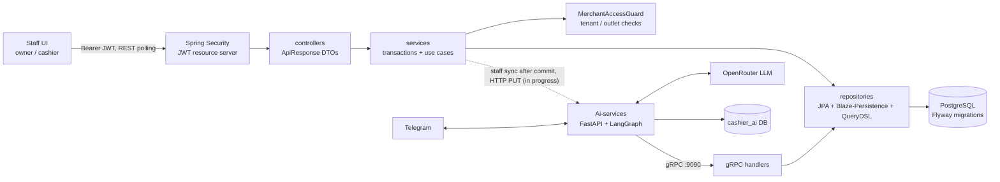
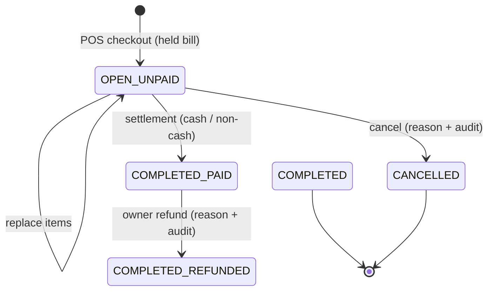

# Cashier SaaS

> Backend POS multi-tenant untuk UMKM F&B: pesan lewat kasir, tahan pesanan, bayar, laporan penjualan.

A multi-tenant POS backend for small food-and-beverage businesses. Cashiers key in orders at the POS; a held bill is an `OPEN` order that is paid later. The flow is `menu -> POS order (held = OPEN) -> payment -> COMPLETED -> sales report`. The backend is a Java 17 / Spring Boot modular monolith on PostgreSQL; clients refresh order lists by polling REST. It also exposes a gRPC API used by a separate Python AI customer-service (Telegram + LLM) to look up menus and order status.


## Key features

Everything below exists in source (`src/main/java/org/lite/project/cashiersaas`).

- **Onboarding and free tier** - account registration (a phone number is required and stored normalized, e.g. `6281234567890`), business intent, free-tier tenant/outlet creation (`OnboardingController`, `RegisterService`, `FreeTierOnboardingService`), public plan catalog.
- **Staff invitations** - owners invite cashiers per outlet; invitation claim (`CashierInvitationController`, token stored as a SHA-256 digest).
- **Staff management and passwords** - owners list an outlet's cashiers and deactivate, reactivate or reset the password of a cashier (`MerchantStaffController`; deactivation revokes sessions and syncs status `DISABLED`; the temporary password is shown once). Any signed-in user can change their own password with `POST /api/v1/auth/password` (`AccountPasswordService`; other sessions are revoked).
- **Catalog and options** - categories, products, options, and **reusable option groups**: groups are an outlet-level library attached to any number of products (replace-all, ordered), with required/min/max rules on the group and archive instead of delete (`FnbCatalogController`, `FnbCatalogService`; migration V5).
- **Inventory and recipes** - per-outlet ingredients with one unit each, a stock balance, an append-only movement ledger (`RESTOCK`, `WASTE`, `ADJUSTMENT`, automatic `SALE`; reason and idempotency key required), and recipes per product and per add-on option. Stock is deducted when an order becomes paid (cash or non-cash) and the payment response carries `stockWarnings`; stock may go negative and a payment is never blocked (`FnbInventoryController`, `FnbInventoryService`, `FnbStockService`; migration V4).
- **POS orders and hold bill** - checkout is audited (`FNB_ORDER_CREATED`); cashier checkout for dine-in/takeaway with an `Idempotency-Key`; an unpaid order stays `OPEN` (held bill) and its items can be replaced with `PUT /api/v1/cashier/outlets/{outletId}/fnb/orders/{orderId}/items` while it is `OPEN` and unpaid (`FnbStaffOrderController`, `FnbPosOrderService`).
- **Discounts** - owner-applied order discounts (`FnbDiscountController`).
- **Cancellation with audit** - reason required, audit record written; a cashier cannot cancel an order that has a discount, only the owner can (`FnbOrderCancellationService`).
- **Cash shifts** - a staff member opens a shift with an opening cash amount and closes it with the counted cash; expected cash = opening + cash received (tender minus change) - cash refunds - petty-cash expenses, and the difference is stored. The opening cash is suggested from the counted cash of the last closed shift, and a member records petty-cash expenses (amount + description, `Idempotency-Key`, audited) while the shift is open. The close summary doubles as the daily report (cash, non-cash per label, expenses, refunds, difference). Payments require the paying member to have an open shift (`409` otherwise). Owners list shifts, read one and force-close any open shift of the outlet (`FnbShiftController`, `FnbShiftService`; migrations V7, V8).
- **Owner refund** - the owner refunds a paid order in full with a reason and an `Idempotency-Key`: payment status becomes `REFUNDED` (the order stays `COMPLETED`), stock is returned through `SALE_REVERSAL` movements, a CASH refund needs the owner's open shift, and the action is audited. Refunded orders drop out of the sales report; their receipt stays available and is marked REFUND (`FnbRefundController`, `FnbRefundService`).
- **Payments (record-only)** - the application only records how the customer paid and never moves money: cash (change is computed) or non-cash, where the cashier must pick an owner-defined label (default `QRIS`, `Transfer`, `Debit`; the label name is stored as a snapshot on the payment). Owners manage the labels per outlet (`FnbPaymentLabelController`; no delete, deactivate instead; max 20, case-insensitive unique). The mock gateway was removed (`FnbPaymentService`; migration V8).
- **Receipts and sales report** - receipt numbers are sequential per outlet per day in the outlet time zone (`INV-YYYYMMDD-NNNN`); the full receipt (business name, logo, outlet contact, items, totals, method and label, change, cashier, customer label, order note, owner-defined footer, and a REFUND marker for refunded orders) is available for paid and refunded orders and printing is optional; owner sales report with a per method and label breakdown and CSV export (`FnbReceiptController`, `FnbSalesReportController`).
- **Unit cost, COGS and stock count (M6)** - a RESTOCK may carry a purchase price (moving-average cost per ingredient, visible to owners only), each paid order item stores its cost, inactive ingredients are no longer deducted, owners record a batch stock count (`POST /api/v1/merchant/outlets/{outletId}/fnb/inventory/stock-counts`, idempotent), and the owner sales report adds COGS, gross profit (total and per menu, with an items-without-cost counter), refunds and hourly, per cashier and per shift sections (migration V9; see `docs/fnb-operations.md`).
- **Order notes and filters** - customer name is optional, orders carry an optional order-level note, and the order list filters by date range (outlet time zone, max 366 days) and exact order number.
- **Owner settings and audit viewer** - business settings (tax, service charge, currency, logo URL, receipt footer) with before/after audit, plus a filtered, paginated audit log (`MerchantBusinessSettingsController`, `MerchantAuditController`).
- **gRPC for the AI service** - `GetCatalogItem`, `GetOrderStatus` (`src/main/proto/cashier_service.proto`, port 9090); money is returned as decimal strings and each request carries `user_id`, which limits results to that staff member's outlets.
- **AI Telegram assistant** - separate Python service in `Ai-services/` (FastAPI, LangGraph, OpenRouter, aiogram) that calls the backend over gRPC.

## Architecture



Order state machine (enforced in `SalesOrderEntity`; `OrderStatus` x `PaymentStatus`):



More detail: [docs/architecture.md](docs/architecture.md).

## Engineering decisions and trade-offs

| Decision | What and why | Trade-off | Where |
|---|---|---|---|
| **Idempotency key + SHA-256 request fingerprint** | Checkout requires an `Idempotency-Key` (16-128 chars). The canonical request (service type, customer label, items, sorted option ids) is hashed and stored on the order. Same key + same fingerprint replays the original order; same key + different request is a conflict (`OperationConflictException`). Option ids are sorted so ordering does not change the hash. | Replays are scoped per tenant + key. | `service/FnbPosOrderService.java`, `service/FnbPaymentService.java` |
| **Tenant-row `PESSIMISTIC_WRITE` lock** | Checkout, replace-items and payment first lock the tenant row (`lockTenant`), serializing concurrent writes so two requests with the same key cannot both insert and order state stays consistent. | It serializes **all mutations of one tenant**: simple and correct, but a throughput bottleneck for a very busy tenant. Per-outlet locks or unique-constraint-and-retry would scale better. Other tenants are unaffected. | `repository/FnbOrderRepository.java` (`lockTenant`) |
| **Tenant isolation via principal, 404 instead of 403** | Tenant and outlet come from the validated JWT principal, never from the request body. `MerchantAccessGuard` re-checks membership/outlet access in the database; a record in another tenant yields `ResourceNotFoundException`, so existence is not leaked. | Each request pays a guard query. | `service/MerchantAccessGuard.java`, `component/TenantJwtAuthenticationConverter.java` |
| **Refresh token digest + rotation** | Refresh tokens are random; only their SHA-256 digest is stored. Each refresh row-locks the session, consumes the old token and issues a new one. Presenting a used or expired token revokes the whole session (reuse detection). The cookie is `HttpOnly`, `SameSite=Strict`, scoped to `/api/v1/auth`, and refresh/logout are CSRF-protected. | Server-side session state exists despite stateless access tokens (access TTL 15 min, refresh 7 days). | `service/AuthSessionService.java`, `component/RefreshCookieService.java`, `configuration/SecurityConfiguration.java` |
| **BigDecimal and price snapshots** | Totals, tax and service charge are computed server-side with `BigDecimal`. Order lines and chosen options store a snapshot of product name and price, and the tax/service rates in effect, so later menu or settings edits do not rewrite history. | More columns and copy logic. | `service/FnbOrderPricingService.java`, `entity/fnb/` |
| **Negative stock allowed, with warnings** | A sale is never blocked by stock: there is no check constraint on `inventory_balances.quantity_on_hand`. Status is derived from `reorder_level` (OK, LOW at or below it, OUT at exactly zero, NEGATIVE below zero) and low/out/negative ingredients are returned as `stockWarnings` in the payment response. | The balance can be wrong in the physical sense until staff restock or adjust; the ledger makes the gap visible rather than refusing the sale. | `service/FnbStockService.java`, `entity/shared/inventory/InventoryBalanceEntity.java`, `db/migration/V4__fnb_inventory_recipe.sql` |
| **Deduct stock on paid, in the payment transaction** | The settle path (`FnbPaymentService.settle`) calls `FnbStockService.consumeForPaidOrder` after the payment row is flushed. It writes one `SALE` movement per (order, ingredient) with key `sale:{orderId}:{inventoryItemId}`, locking balances in ascending ingredient id after the tenant lock. A paid order cannot be cancelled; the only reversal is the owner refund, which writes `SALE_REVERSAL` movements. | Unpaid orders reserve nothing, so stock is only consumed at settlement. Deactivating an ingredient keeps its recipe lines but, since M6, an inactive ingredient is no longer deducted. | `service/FnbStockService.java`, `service/FnbPaymentService.java`, `entity/fnb/SalesOrderEntity.java` |
| **Flyway + Hibernate `validate`** | Schema is owned by versioned SQL migrations; Hibernate only validates (`ddl-auto=validate`), so entity/schema drift fails at startup instead of silently mutating a database. | Every model change needs a hand-written migration. | `src/main/resources/db/migration/`, `application.properties` |

## Tech stack

| Area | Technology |
|---|---|
| Language / runtime | Java 17 |
| Framework | Spring Boot 4.1.1 (MVC, Security, OAuth2 resource server, Validation) |
| Persistence | PostgreSQL, Spring Data JPA / Hibernate, Blaze-Persistence, QueryDSL, Flyway |
| Auth | HS256 JWT (ACCOUNT and MERCHANT scopes), BCrypt, rotating refresh tokens |
| API docs | springdoc-openapi (Swagger UI) |
| RPC | gRPC + Protobuf (`grpc-server-spring-boot-starter`) |
| AI service | Python 3.12, FastAPI, LangGraph / LangChain, aiogram (Telegram), OpenRouter, SQLAlchemy async + Alembic, uv |
| Build | Maven wrapper, Lombok |
| Tests | Spring Boot test starters; integration tests use Testcontainers |

## Quick start (Docker)

Prerequisite: Docker with Compose. The first build downloads Maven dependencies and takes several minutes.

```bash
cp .env.example .env                 # PowerShell: Copy-Item .env.example .env
# set CASHIER_JWT_SECRET_B64, CASHIER_GRPC_SERVICE_KEY and AI_INTERNAL_API_KEY in .env (compose refuses to start without them).
# The two service keys must be different values:
openssl rand -base64 32              # PowerShell: [Convert]::ToBase64String([System.Security.Cryptography.RandomNumberGenerator]::GetBytes(32))

docker compose up -d --build                 # postgres + backend (demo profile, seeded)
docker compose --profile ai up -d --build    # optional: also the AI customer-service
docker compose down -v                       # stop and delete data
```

| Service | URL / port |
|---|---|
| REST API | http://localhost:8080 (override: `BACKEND_HTTP_PORT`) |
| Swagger UI | http://localhost:8080/swagger-ui.html (redirects to `/swagger-ui/index.html`) |
| OpenAPI JSON | http://localhost:8080/v3/api-docs |
| gRPC | not published to the host; internal compose network only (`backend:9090`), callers must send `CASHIER_GRPC_SERVICE_KEY` |
| PostgreSQL 17 | localhost:5432 (override: `POSTGRES_HOST_PORT`), user `cashier` / `cashier_demo`, dbs `cashier_saas` and `cashier_ai` |
| AI service (profile `ai`) | http://localhost:8001 (override: `AI_HTTP_PORT`) |

Demo data: tenant **Kopi Demo**, outlet **Kopi Demo - Pusat**; the seed also contains seven ingredients with recipes (Gula Aren starts below its reorder level so a LOW warning is visible). Accounts (password `Demo123!`): `owner@demo.local` (OWNERMERCHANT) and `cashier@demo.local` (CASHIER). Login with `POST /api/v1/auth/login`, then `POST /api/v1/auth/select-merchant` with `{tenantId, outletId}` to get an operational token. Full walkthrough with ids and a curl flow: [docs/demo.md](docs/demo.md).

The Telegram assistant needs `TELEGRAM_BOT_TOKEN`, `OPENROUTER_API_KEY`, `AI_MODEL` and the shared `AI_INTERNAL_API_KEY` in `.env`; see `Ai-services/README.md` (Indonesian).

### Staff identity for the Telegram assistant (in progress)

This flow is under active development and is not yet verified end to end. The contract is in [docs/contracts/member-sync.md](docs/contracts/member-sync.md).

- **Registration** requires a phone number. The number is normalized to digits with a country code (Indonesian local numbers such as `0812-3456-7890` become `6281234567890`).
- **Staff sync**: when an owner completes the business profile, and when a cashier invitation is claimed, the backend pushes the staff member's tenant, full name, normalized phone, role and status to Ai-services (`PUT` on the internal member API, authenticated by `AI_INTERNAL_API_KEY`). Sync is best-effort and runs after the business transaction commits; a failed sync does not fail registration or invitation claim. Sync is disabled when `AI_SERVICE_BASE_URL` is blank.
- **Telegram identification**: a Telegram user proves who they are by sharing their own Telegram contact (the contact must belong to the sender). The phone number is then matched against the synced staff list. Typed phone numbers are ignored, and forwarded or foreign contacts are rejected. A user who matches several tenants chooses one, and `/tenant` switches between verified tenants.
- **Tenant resolution**: for verified users the tenant and role come from the verified membership on every message. `AI_TENANT_ID` is only a **development fallback** for unverified or local use; it never overrides a verified tenant.

## Running tests

```bash
./mvnw verify          # Windows: mvnw.cmd verify
```

Unit tests run through surefire (`mvn test` stays database-free). Integration tests run through failsafe against a real PostgreSQL 17 container via Testcontainers, so Docker must be running. The last recorded run is `mvnw -B verify` on 2026-11-10 (run by the project orchestrator, PostgreSQL 17.11 via Testcontainers): 460 unit and 77 integration tests passed. The integration suite exercises the real security chain and transactions and covers:

- the Pay First POS flow end to end (held order OPEN/UNPAID, replace items, cash payment with change, order COMPLETED, sales report);
- POS checkout idempotency (same key and body replays, same key and different body conflicts);
- payment replay and conflict handling;
- concurrent double-pay with different keys settles exactly once (one payment row);
- cross-tenant access returns 404 and cannot pay another tenant's order;
- application context, Flyway migrations and Hibernate schema validation on real PostgreSQL;
- inventory flow (`FnbInventoryFlowIntegrationTest`, 13 tests): a paid order deducts product and add-on recipes with one `SALE` movement per ingredient, negative stock never blocks payment, LOW/OUT warnings, a replayed payment key does not deduct twice, cancelling an unpaid order creates no movements, CASHIER may RESTOCK/WASTE while ADJUSTMENT, ingredient and recipe management stay owner-only, and cross-tenant access to ingredients fails;
- reusable option groups (`FnbReusableOptionGroupIntegrationTest`, 6 tests): one shared option attached to two products deducts its recipe once per ordered unit, orders enforce required groups and reject options of groups not attached to the product, archiving an attached group conflicts until it is detached, attach replaces all links in request order, and a cashier can only read;
- stock concurrency (`FnbStockConcurrencyIntegrationTest`, 10 tests): parallel same-key movements apply once (and a sequential replay or conflicting payload afterwards behaves deterministically), parallel distinct-key restocks and wastes lose no update, parallel payments of different orders and of one order (same or different keys) deduct the shared ingredient exactly once per order, a mixed payment/restock/waste load finishes without deadlock with the ledger matching the balance, negative stock never blocks parallel payments, and a payment racing with a cancel or with a discount (15 rounds each) always ends in one consistent state with no server error.

Mutation check of the concurrency tests (2026-11-10, six single-line mutants applied one at a time, only `FnbStockConcurrencyIntegrationTest` run, up to 3 runs per surviving mutant). First round (8 tests): removing the balance row lock in `recordMovement` (killed), removing the balance row lock in `FnbStockService` (killed), flipping the sale sign (killed), disabling the idempotency-fingerprint conflict check (killed only on the second of two runs: that scenario depended on the parallel requests overlapping), removing the per-(order, ingredient) sale guard in `FnbStockService` (survived the concurrency suite, killed by the unit test `FnbStockServiceTest`), and removing `lockTenant` from `FnbPaymentService.pay` (survived 3/3 runs). Second round after adding the payment-vs-cancel and payment-vs-discount races and deterministic replay/conflict checks (10 tests): removing `lockTenant` from `pay` is now killed on the first run, by both race tests with a `500` response (without the tenant lock a payment racing with a cancel or discount fails the order version check, and `GlobalExceptionHandler` reports it as a generic server error); the fingerprint mutant is killed on the first run, by the parallel assertion of the different-payload scenario (the requests overlapped in that run; the new sequential checks would fail it even without overlap, but that was not observed in isolation).

Not covered: concurrency over a real network (the concurrency tests drive the application in-process against a real PostgreSQL); the frontend; and any Postman run against a live server. An optimistic-lock failure is reported as a retryable `409` (`GlobalExceptionHandler`, unit-tested), but no integration test provokes a real lost `@Version` race, because the tenant row lock prevents it.

## Local development without Docker

Requires JDK 17 and a local **PostgreSQL 17 or newer** (the V1 migration uses `SET transaction_timeout`, which PostgreSQL 16 rejects). Environment variables read by `application.properties`:

| Variable | Purpose | Default |
|---|---|---|
| `CASHIER_DB_URL` | JDBC URL | `jdbc:postgresql://localhost:5432/cashier_saas_migrated` |
| `CASHIER_DB_USERNAME` / `CASHIER_DB_PASSWORD` | DB credentials | see `application.properties` |
| `CASHIER_JWT_SECRET_B64` | **required**, Base64 of at least 32 random bytes | none |
| `CASHIER_JWT_ISSUER` / `CASHIER_JWT_AUDIENCE` | token issuer / audience | `cashier-saas` / `cashier-saas-api` |
| `CASHIER_REFRESH_COOKIE_SECURE` | set `false` for plain-HTTP local use | `true` |
| `CASHIER_GRPC_PORT` | gRPC port | `9090` |
| `CASHIER_GRPC_SERVICE_KEY` | **required**, shared secret for gRPC callers (`x-internal-service-key` metadata), at least 16 characters | none |
| `AI_SERVICE_BASE_URL` | base URL of Ai-services for staff sync (in progress); blank disables sync | blank |
| `AI_INTERNAL_API_KEY` | shared secret for the Ai-services internal member API (`X-Internal-Service-Key`), at least 16 characters, different from `CASHIER_GRPC_SERVICE_KEY` (in progress) | none |
| `CASHIER_CORS_ALLOWED_ORIGINS` | comma-separated browser origins allowed by CORS (property `app.cors.allowed-origins`); each must be an explicit `http`/`https` origin with no path, `*` is rejected and an invalid value fails startup | `http://localhost:5173,http://127.0.0.1:5173` |
| `CASHIER_DB_POOL_MAX_SIZE` | Hikari pool size | `10` |

A `.env` file in the working directory is also imported (`spring.config.import`). Then:

```bash
./mvnw spring-boot:run
```

Flyway applies migrations on startup. Set `SPRING_PROFILES_ACTIVE=demo` to load the demo seed (it also inserts the `FNB` row in `business_types`, which free-tier onboarding requires and the migrations do not create).

## Project structure

```
cashier-saas/
|-- src/main/java/org/lite/project/cashiersaas/
|   |-- controller/      REST adapters (return ApiResponse<T>)
|   |-- service/         use cases, transactions, guards, pricing, payments
|   |-- repository/      JPA / Blaze-Persistence / QueryDSL data access
|   |-- entity/          fnb, shared (identity, merchant, catalog, audit...), laundry
|   |-- dto/             request/response DTOs and explicit mappers
|   |-- component/       JWT, principals, rate limiting
|   |-- configuration/   security, JWT, OpenAPI
|   |-- grpc/            gRPC service, handlers, mappers
|   `-- enums/ exception/ shared/
|-- src/main/proto/      cashier_service.proto
|-- src/main/resources/  application.properties, db/migration (Flyway)
|-- Ai-services/         Python AI customer-service (FastAPI, LangGraph, Telegram)
|-- docs/                architecture.md, demo.md, fnb-*.md, database/, testing/
|-- reports/ tasks/ .ai/ delivery reports and planning notes
`-- PRD-MVP.md           product requirements (Indonesian)
```

## Roadmap and known limitations

- **Payments are record-only.** No payment provider, QRIS or EDC integration exists and the application never processes money; non-cash payments are recorded with an owner-defined label so the owner can reconcile them with bank statements.
- **No real-time push.** The UI polls REST (every 15 s, plus refetch on window focus and after its own mutations); the PRD target of an order being visible within 5 seconds is not guaranteed.
- **Shifts and refunds:** one open shift per member and outlet; payments need the payer's own shift; refunds are full only (no partial refund) and non-cash refunds do not move the cash drawer; petty-cash expenses are not capped against the expected cash (it may go negative).
- **Tenant lock is a bottleneck** for a very busy single tenant (see trade-offs).
- **gRPC is protected by a shared service key and a database tenant check.** Callers must send `CASHIER_GRPC_SERVICE_KEY`; a request tenant is served only when the tenant exists and is active (a missing and an inactive tenant get the same response). The env tenant allowlist was removed. `tenant_id` is still a request field. The demo compose file does not publish 9090 to the host; it is reachable only on the internal compose network. Token-bound tenant identity is a follow-up item.
- **Staff sync to the AI service and Telegram identity verification are in progress** (see the section above). Until they are verified, do not rely on `AI_TENANT_ID` for tenant resolution.
- **AI service container is built but not runtime-verified** (needs real Telegram/OpenRouter credentials).
- **Test gaps:** concurrency over a real network, and a Postman run against a live server are not covered (see Running tests for the mutation check). CASHIER-role paths are covered for the inventory flows only.
- **Optimistic lock:** a concurrent write that loses an optimistic-lock (`@Version`) race is reported as a retryable `409` ("Data baru saja diubah oleh proses lain..."); the tenant row lock normally prevents the race, which is what the payment-vs-cancel and payment-vs-discount tests rely on.
- **Rate limiting:** the REST API is throttled by an in-memory token-bucket filter (HTTP `429` with `Retry-After`). Groups are `AUTH`, `AUTHENTICATED` and `ANONYMOUS_OTHER`. Limits are tunable through `CASHIER_RATE_LIMIT_*` (see `.env.example`); the tests run with it disabled. Single instance only; behind a reverse proxy set `server.forward-headers-strategy=native`.
- **Frontend lives in a separate repository** (`cashier-saas-ui`); this repo is backend only.
- **WhatsApp channel is deferred**; only Telegram is active in the AI service.
- **Inventory and recipes are implemented for F&B** by explicit user decision, although `PRD-MVP.md` section 5 still lists them as post-MVP (see `.ai/DECISIONS.md`). Known limits:
  - one unit per ingredient, no unit conversion;
  - stock can go negative and warns instead of blocking;
  - parallel movements with the same idempotency key may return 409 to the loser instead of a replay (the balance still changes once);
  - deactivating an ingredient does not stop existing recipe lines from deducting it;
  - `archiveGroup` takes no lock, the option-group response does not list its products, and attaching or detaching groups writes no audit row (recipe changes do);
  - no supplier or purchasing workflow (still post-MVP in the PRD).
- Laundry entities exist in code but are outside the F&B MVP scope.
- Roles are limited to `SUPERADMIN`, `OWNERMERCHANT`, `CASHIER`. The PRD mentions Manager/Kitchen roles and pay-after-meal flows; they are not implemented. Customer QR ordering, kitchen queue, dining tables and WebSocket real-time were removed in the cashier-first pivot (2026-11-12; see `.ai/DECISIONS.md`).

## License

TBD.

Author: finn
