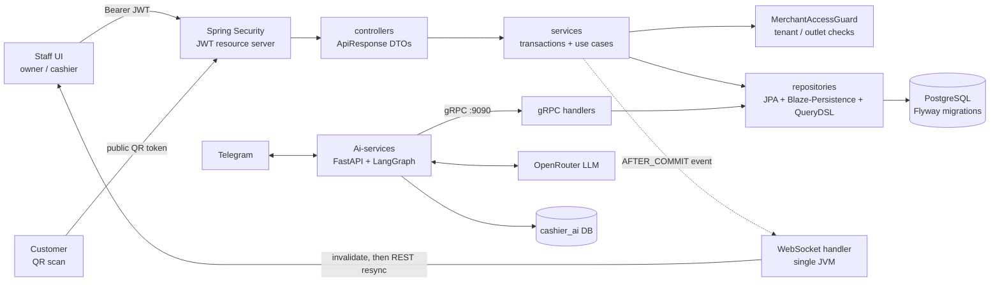
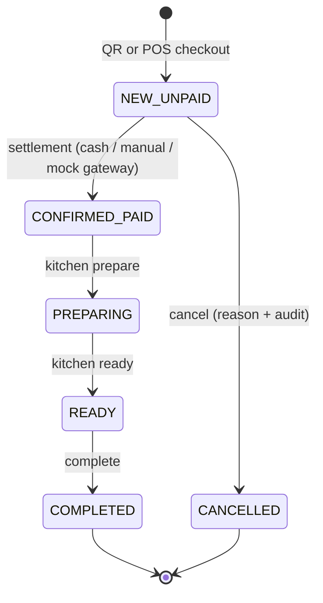

# Cashier SaaS

> Backend POS multi-tenant untuk UMKM F&B: pesan lewat QR atau kasir, bayar dulu, dapur langsung tahu.

A multi-tenant POS backend for small food-and-beverage businesses. Customers order from a QR code on the table while cashiers key in walk-in orders; both feed **one** order model that follows a **Pay First** flow (order, pay, kitchen, complete, report). The backend is a Java 17 / Spring Boot modular monolith on PostgreSQL, with a realtime WebSocket channel for kitchen/cashier screens and a gRPC API used by a separate Python AI customer-service (Telegram + LLM) to look up menus and order status.


## Key features

Everything below exists in source (`src/main/java/org/lite/project/cashiersaas`).

- **Onboarding and free tier** - account registration, business intent, free-tier tenant/outlet creation (`OnboardingController`, `FreeTierOnboardingService`), public plan catalog.
- **Staff invitations** - owners invite cashiers per outlet; invitation claim (`CashierInvitationController`, token stored as a SHA-256 digest).
- **Catalog and options** - categories, products, option groups and options, with availability (`FnbCatalogController`).
- **Tables and QR** - dining tables, per-table and per-outlet QR tokens with rotation (`FnbTableController`, `FnbOrderQrController`).
- **Public QR ordering** - anonymous menu by QR token and order submission with an `Idempotency-Key`; order status by opaque order token (`PublicOrderController`).
- **POS orders** - cashier checkout for dine-in/takeaway (`FnbStaffOrderController`, `FnbPosOrderService`).
- **Discounts** - owner-applied order discounts (`FnbDiscountController`).
- **Cancellation with audit** - reason required, audit record written (`FnbOrderCancellationService`).
- **Payments** - cash, manual non-cash and a **mock gateway** with explicit attempt resolution (`FnbPaymentService`, `MockFnbGatewayService`).
- **Kitchen flow** - prepare / ready / complete transitions (`FnbKitchenController`).
- **Receipts and sales report** - receipt per order; owner sales report with CSV export (`FnbReceiptController`, `FnbSalesReportController`).
- **Owner settings and audit viewer** - business settings (tax, service charge, currency, logo URL) with before/after audit, plus a filtered, paginated audit log (`MerchantBusinessSettingsController`, `MerchantAuditController`).
- **Realtime WebSocket** - order-change invalidation events for staff screens (`FnbRealtimeController`, `FnbRealtimeWebSocketHandler`).
- **gRPC for the AI service** - `GetCatalogItem`, `GetOrderStatus` (`src/main/proto/cashier_service.proto`, port 9090).
- **AI Telegram assistant** - separate Python service in `Ai-services/` (FastAPI, LangGraph, OpenRouter, aiogram) that calls the backend over gRPC.

## Architecture



Order state machine (enforced in `SalesOrderEntity`; `OrderStatus` x `PaymentStatus`):



More detail: [docs/architecture.md](docs/architecture.md).

## Engineering decisions and trade-offs

| Decision | What and why | Trade-off | Where |
|---|---|---|---|
| **Idempotency key + SHA-256 request fingerprint** | Checkout requires an `Idempotency-Key` (16-128 chars). The canonical request (service type, table, customer label, items, sorted option ids) is hashed and stored on the order. Same key + same fingerprint replays the original order; same key + different request is a conflict (`OperationConflictException`). Option ids are sorted so ordering does not change the hash. | Replays are scoped per tenant + key. | `service/FnbPosOrderService.java`, `service/PublicOrderService.java`, `service/FnbPaymentService.java` |
| **Tenant-row `PESSIMISTIC_WRITE` lock** | Checkout (and payment/kitchen coordination) first locks the tenant row (`lockTenant`), serializing concurrent writes so two requests with the same key cannot both insert and table/order state stays consistent. | It serializes **all mutations of one tenant**: simple and correct, but a throughput bottleneck for a very busy tenant. Per-outlet locks or unique-constraint-and-retry would scale better. Other tenants are unaffected. | `repository/FnbOrderRepository.java` (`lockTenant`) |
| **Tenant isolation via principal, 404 instead of 403** | Tenant and outlet come from the validated JWT principal, never from the request body. `MerchantAccessGuard` re-checks membership/outlet access in the database; a record in another tenant yields `ResourceNotFoundException`, so existence is not leaked. | Each request pays a guard query. | `service/MerchantAccessGuard.java`, `component/TenantJwtAuthenticationConverter.java` |
| **Refresh token digest + rotation** | Refresh tokens are random; only their SHA-256 digest is stored. Each refresh row-locks the session, consumes the old token and issues a new one. Presenting a used or expired token revokes the whole session (reuse detection). The cookie is `HttpOnly`, `SameSite=Strict`, scoped to `/api/v1/auth`, and refresh/logout are CSRF-protected. | Server-side session state exists despite stateless access tokens (access TTL 15 min, refresh 7 days). | `service/AuthSessionService.java`, `component/RefreshCookieService.java`, `configuration/SecurityConfiguration.java` |
| **WebSocket single-use ticket via `Sec-WebSocket-Protocol`** | Browsers cannot send a Bearer header on a WebSocket upgrade, and URL tokens leak into logs. The client first calls an authenticated REST endpoint for a 32-byte random ticket (TTL max 30 s, stored as a digest in memory, consumed on use, capped per principal). It is then sent as the `ticket.<value>` subprotocol next to `cashier-fnb-v1`; handshakes with a query string are rejected. | The ticket store is in memory, so it is per-JVM. | `service/FnbRealtimeTicketService.java`, `component/FnbRealtimeHandshakeInterceptor.java` |
| **AFTER_COMMIT events + REST resync** | Services publish a minimal invalidation event; a `@TransactionalEventListener(AFTER_COMMIT)` hands it to a bounded executor (queue 1000, abort policy). Clients never see uncommitted state, and a failed or dropped delivery never fails the business transaction. Clients re-fetch via REST and poll as a fallback. | Best-effort, single JVM, no replay or broker. | `component/FnbOrderChangedListener.java`, `configuration/FnbWebSocketConfiguration.java`, `service/FnbRealtimePublisher.java` |
| **BigDecimal and price snapshots** | Totals, tax and service charge are computed server-side with `BigDecimal`. Order lines and chosen options store a snapshot of product name and price, and the tax/service rates in effect, so later menu or settings edits do not rewrite history. | More columns and copy logic. | `service/FnbOrderPricingService.java`, `entity/fnb/` |
| **Flyway + Hibernate `validate`** | Schema is owned by versioned SQL migrations; Hibernate only validates (`ddl-auto=validate`), so entity/schema drift fails at startup instead of silently mutating a database. | Every model change needs a hand-written migration. | `src/main/resources/db/migration/`, `application.properties` |

## Tech stack

| Area | Technology |
|---|---|
| Language / runtime | Java 17 |
| Framework | Spring Boot 4.1.1 (MVC, Security, OAuth2 resource server, WebSocket, Validation) |
| Persistence | PostgreSQL, Spring Data JPA / Hibernate, Blaze-Persistence, QueryDSL, Flyway |
| Auth | HS256 JWT (ACCOUNT and MERCHANT scopes), BCrypt, rotating refresh tokens |
| API docs | springdoc-openapi (Swagger UI) |
| RPC | gRPC + Protobuf (`grpc-server-spring-boot-starter`) |
| AI service | Python 3.12, FastAPI, LangGraph / LangChain, aiogram (Telegram), OpenRouter, SQLAlchemy async + Alembic, uv |
| Build | Maven wrapper, Lombok |
| Tests | Spring Boot test starters; integration tests use Testcontainers |

## Quick start (Docker)

Prerequisite: Docker with Compose. The first build downloads Maven dependencies and takes several minutes.

```bash
cp .env.example .env                 # PowerShell: Copy-Item .env.example .env
# set CASHIER_JWT_SECRET_B64 and CASHIER_GRPC_SERVICE_KEY in .env (compose refuses to start without them):
openssl rand -base64 32              # PowerShell: [Convert]::ToBase64String([System.Security.Cryptography.RandomNumberGenerator]::GetBytes(32))

docker compose up -d --build                 # postgres + backend (demo profile, seeded)
docker compose --profile ai up -d --build    # optional: also the AI customer-service
docker compose down -v                       # stop and delete data
```

| Service | URL / port |
|---|---|
| REST API | http://localhost:8080 (override: `BACKEND_HTTP_PORT`) |
| Swagger UI | http://localhost:8080/swagger-ui.html (redirects to `/swagger-ui/index.html`) |
| OpenAPI JSON | http://localhost:8080/v3/api-docs |
| gRPC | not published to the host; internal compose network only (`backend:9090`), callers must send `CASHIER_GRPC_SERVICE_KEY` |
| PostgreSQL 17 | localhost:5432 (override: `POSTGRES_HOST_PORT`), user `cashier` / `cashier_demo`, dbs `cashier_saas` and `cashier_ai` |
| AI service (profile `ai`) | http://localhost:8001 (override: `AI_HTTP_PORT`) |

Demo data: tenant **Kopi Demo**, outlet **Kopi Demo - Pusat**. Accounts (password `Demo123!`): `owner@demo.local` (OWNERMERCHANT) and `cashier@demo.local` (CASHIER). Login with `POST /api/v1/auth/login`, then `POST /api/v1/auth/select-merchant` with `{tenantId, outletId}` to get an operational token. Full walkthrough with ids, QR tokens and a curl flow: [docs/demo.md](docs/demo.md).

The Telegram assistant needs `TELEGRAM_BOT_TOKEN`, `OPENROUTER_API_KEY` and `AI_MODEL` in `.env`; see `Ai-services/README.md` (Indonesian).

## Running tests

```bash
./mvnw verify          # Windows: mvnw.cmd verify
```

Unit tests run through surefire (`mvn test` stays database-free). Integration tests run through failsafe against a real PostgreSQL 17 container via Testcontainers, so Docker must be running. The last recorded run (`reports/TASK-054.md`) passed 200 unit and 10 integration tests. The integration suite exercises the real security chain and transactions and proves:

- the Pay First POS flow end to end (order NEW/UNPAID, kitchen blocked until paid, cash payment with change, kitchen to COMPLETED, sales report);
- public QR ordering with idempotency (same key and body replays, same key and different body conflicts);
- payment replay and conflict handling;
- concurrent double-pay with different keys settles exactly once (one payment row);
- cross-tenant access returns 404 and cannot pay another tenant's order;
- application context, Flyway migrations and Hibernate schema validation on real PostgreSQL.

Not yet covered: CASHIER-role token paths and MOCK_GATEWAY payments.

## Local development without Docker

Requires JDK 17 and a local **PostgreSQL 17 or newer** (the V1 migration uses `SET transaction_timeout`, which PostgreSQL 16 rejects). Environment variables read by `application.properties`:

| Variable | Purpose | Default |
|---|---|---|
| `CASHIER_DB_URL` | JDBC URL | `jdbc:postgresql://localhost:5432/cashier_saas_migrated` |
| `CASHIER_DB_USERNAME` / `CASHIER_DB_PASSWORD` | DB credentials | see `application.properties` |
| `CASHIER_JWT_SECRET_B64` | **required**, Base64 of at least 32 random bytes | none |
| `CASHIER_JWT_ISSUER` / `CASHIER_JWT_AUDIENCE` | token issuer / audience | `cashier-saas` / `cashier-saas-api` |
| `CASHIER_REFRESH_COOKIE_SECURE` | set `false` for plain-HTTP local use | `true` |
| `CASHIER_GRPC_PORT` | gRPC port | `9090` |
| `CASHIER_GRPC_SERVICE_KEY` | **required**, shared secret for gRPC callers (`x-internal-service-key` metadata), at least 16 characters | none |
| `CASHIER_GRPC_ALLOWED_TENANT_IDS` | comma-separated tenant UUIDs that gRPC may serve; empty denies all | empty |
| `CASHIER_DB_POOL_MAX_SIZE` | Hikari pool size | `10` |

A `.env` file in the working directory is also imported (`spring.config.import`). Then:

```bash
./mvnw spring-boot:run
```

Flyway applies migrations on startup. Set `SPRING_PROFILES_ACTIVE=demo` to load the demo seed (it also inserts the `FNB` row in `business_types`, which free-tier onboarding requires and the migrations do not create).

## Project structure

```
cashier-saas/
|-- src/main/java/org/lite/project/cashiersaas/
|   |-- controller/      REST adapters (return ApiResponse<T>)
|   |-- service/         use cases, transactions, guards, pricing, payments
|   |-- repository/      JPA / Blaze-Persistence / QueryDSL data access
|   |-- entity/          fnb, shared (identity, merchant, catalog, audit...), laundry
|   |-- dto/             request/response DTOs and explicit mappers
|   |-- component/       JWT, principals, realtime handshake/handler, events
|   |-- configuration/   security, JWT, OpenAPI, WebSocket
|   |-- grpc/            gRPC service, handlers, mappers
|   `-- enums/ exception/ shared/
|-- src/main/proto/      cashier_service.proto
|-- src/main/resources/  application.properties, db/migration (Flyway)
|-- Ai-services/         Python AI customer-service (FastAPI, LangGraph, Telegram)
|-- docs/                architecture.md, demo.md, fnb-*.md, database/, testing/
|-- reports/ tasks/ .ai/ delivery reports and planning notes
`-- PRD-MVP.md           product requirements (Indonesian)
```

## Roadmap and known limitations

- **Payments use a mock gateway.** No real payment provider is integrated.
- **Realtime is single-JVM.** No message broker, replay or cross-node fan-out; clients must resync via REST.
- **Tenant lock is a bottleneck** for a very busy single tenant (see trade-offs).
- **gRPC is protected by a shared service key and a tenant allowlist** (`CASHIER_GRPC_SERVICE_KEY`, `CASHIER_GRPC_ALLOWED_TENANT_IDS`), but `tenant_id` is still a request field. The demo compose file does not publish 9090 to the host; it is reachable only on the internal compose network. Token-bound tenant identity is a follow-up item.
- **AI service container is built but not runtime-verified** (needs real Telegram/OpenRouter credentials).
- **Test gaps:** CASHIER-role paths and MOCK_GATEWAY payments have no integration tests yet.
- **Frontend lives in a separate repository** (`cashier-saas-ui`); this repo is backend only.
- **WhatsApp channel is deferred**; only Telegram is active in the AI service.
- Laundry and inventory entities exist in code but are outside the F&B MVP scope.
- Roles are limited to `SUPERADMIN`, `OWNERMERCHANT`, `CASHIER`. The PRD mentions Manager/Kitchen roles and pay-after-meal flows; they are not implemented.

## License

TBD.

Author: finn
