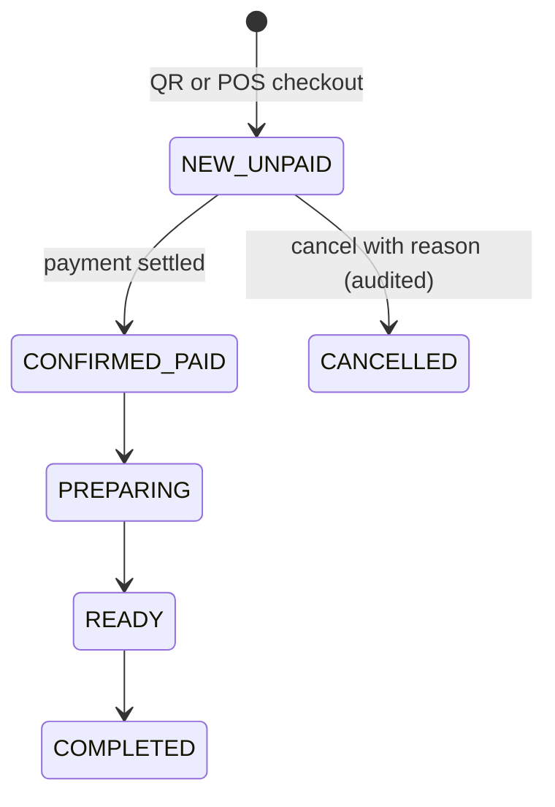
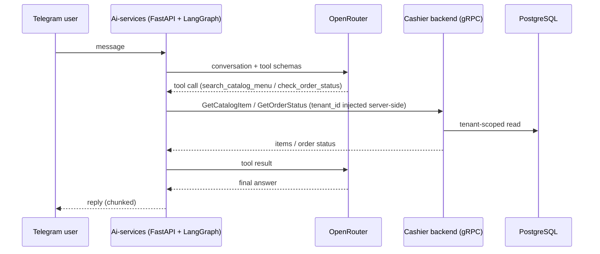

# Architecture

Backend architecture of Cashier SaaS. All paths are relative to `src/main/java/org/lite/project/cashiersaas` unless noted. See the [README](../README.md) for the summary.

## 1. Module boundaries

One deployable Spring Boot application (modular monolith). Layering is by top-level package; there are no per-feature root packages.

| Package | Responsibility |
|---|---|
| `controller` | HTTP adapters. Return `ApiResponse<T>`; errors are mapped centrally by `GlobalExceptionHandler`. |
| `service` | Use cases and transaction boundaries. Identity/sessions (`LoginService`, `RegisterService`, `AuthSessionService`), merchant foundation (`FreeTierOnboardingService`, `CashierInvitationService`, `OutletService`), F&B operations (`Fnb*Service`, `PublicOrderService`, `MockFnbGatewayService`), settings and audit (`MerchantBusinessSettingsService`, `MerchantAuditService`). |
| `service/MerchantAccessGuard` | Reusable tenant/outlet authorization policy; resolves a `MerchantAccessContext` from the principal. |
| `repository` | Persistence via `EntityManager`, Blaze-Persistence and QueryDSL typed paths. |
| `entity` | `fnb` (orders, items, payments, discounts, tables, QR, gateway attempts), `shared` (identity, merchant, catalog, audit, billing...), `laundry`. Entities own named transitions (e.g. `SalesOrderEntity`). |
| `dto` | Named request/response classes and explicit mappers; entities are never returned by controllers. |
| `component`, `configuration` | JWT/principal infrastructure, realtime handshake/handler/events; security, JWT, OpenAPI, WebSocket wiring. |
| `grpc` | gRPC service plus catalog/order handlers and mappers. |

Dependency direction: controller -> service -> (guard, repository, mapper). Services publish realtime events through `FnbRealtimePublisher`.

The F&B module is the active MVP. Laundry, inventory and the older generic "cashier sale/catalog" entities exist in the codebase but are not part of the F&B flow described here.

## 2. Security model

### Roles

Exactly three: `SUPERADMIN`, `OWNERMERCHANT`, `CASHIER` (`enums/Role`). URL policy (`configuration/SecurityConfiguration`):

| Path prefix | Requirement |
|---|---|
| `/api/v1/auth/login`, `/register`, `/refresh`, `/logout`, `GET /auth/csrf` | anonymous |
| `/api/v1/auth/select-merchant`, `/auth/outlets`, `/api/v1/onboarding/**` | authority `SCOPE_ACCOUNT` |
| `/api/v1/public/**`, Swagger (`/swagger-ui.html`, `/swagger-ui/**`, `/v3/api-docs/**`) | anonymous (public QR routes are authorized by the QR token) |
| `GET /api/v1/fnb/realtime` | anonymous at HTTP level; the handshake interceptor requires a one-time ticket |
| `/api/v1/merchant/**` | `OWNERMERCHANT` |
| `/api/v1/cashier/**` | `OWNERMERCHANT` or `CASHIER` |
| `/api/v1/platform/**` | `SUPERADMIN` (the rule exists; no controller under this prefix was found in source) |

### Token scopes

- **ACCOUNT scope** - issued after login/registration. Identifies a user only; allows onboarding and choosing a merchant/outlet.
- **MERCHANT scope** - issued after `select-merchant` (and by refresh for an existing session). Carries user, session, tenant, outlet and membership claims plus roles. `TenantJwtAuthenticationConverter` requires these claims and produces a `TenantPrincipal`.

JWTs are HS256 with a mandatory Base64 secret (`CASHIER_JWT_SECRET_B64`, at least 32 bytes), validated issuer/audience/expiry (`configuration/JwtConfiguration`, `component/AudienceValidator`). Access TTL is 15 minutes; refresh TTL 7 days.

### Tenant isolation

Services receive a `TenantPrincipal`; tenant and outlet are never read from a request body. `MerchantAccessGuard.requireOutlet` reloads membership and outlet access from the database. Repositories filter on tenant (and outlet) ids. A missing or foreign record raises `ResourceNotFoundException` (404), so a caller cannot distinguish "not yours" from "does not exist". Public QR routes derive tenant/outlet/table from the server-side QR token record.

### Sessions

`AuthSessionService` stores sessions and refresh-token digests (SHA-256). `refresh` locks the session row, requires an unused, unexpired token, consumes it and issues a replacement; a replayed token revokes the session. The refresh cookie is `HttpOnly`, `SameSite=Strict`, path `/api/v1/auth`; refresh and logout require a CSRF token (`/auth/csrf`).

## 3. Order lifecycle

`OrderStatus` = NEW, CONFIRMED, PREPARING, READY, COMPLETED, CANCELLED. `PaymentStatus` = UNPAID, PAID, REFUNDED. `PaymentMethod` = CASH, MANUAL_NON_CASH, MOCK_GATEWAY. Discount and cancellation are only allowed while the order is NEW/UNPAID. `SalesOrderEntity` validates transitions.

## 4. Request flows

### Checkout (POS)

`POST /api/v1/cashier/outlets/{outletId}/fnb/orders` with `Idempotency-Key` (`FnbPosOrderService.checkout`), in one transaction:

1. `guard.requireOutlet` - resolve tenant/outlet from the principal.
2. Validate key format (16-128 chars `[A-Za-z0-9_-]`) and compute the SHA-256 request fingerprint.
3. `orders.lockTenant` (`PESSIMISTIC_WRITE` on the tenant row), then re-run the guard and check tenant/outlet are active and F&B-enabled.
4. Look up an existing order by (tenant, key). If found: same source/outlet/fingerprint replays the stored order, otherwise `409`.
5. Price server-side (`FnbOrderPricingService`): availability re-checked, `BigDecimal` subtotal, tax and service charge from tenant rates.
6. Persist `SalesOrderEntity` (NEW/UNPAID) with item and option snapshots; mark a selected table as awaiting payment.
7. `realtime.orderChanged("ORDER_CREATED", order)` - published as an event; delivered only after commit.

The public QR path (`POST /api/v1/public/fnb/menu/{qrToken}/orders`, `PublicOrderService`) follows the same structure, with the tenant/outlet/table resolved from the QR token and a status token returned for `GET /api/v1/public/fnb/orders/{orderToken}/status`.

### Payment

`POST /api/v1/cashier/outlets/{outletId}/fnb/orders/{orderId}/payments` (`FnbPaymentService`): lock tenant, load the order within tenant/outlet, reject if already paid (conflict), and honor a payment idempotency/fingerprint check (a reused key is a conflict; replay returns the prior result). CASH and MANUAL_NON_CASH settle directly; MOCK_GATEWAY creates a gateway attempt (`FnbGatewayAttemptEntity`) that is later resolved with `POST .../mock-payments/{attemptId}/resolve` (`MockFnbGatewayService`, outcomes in `FnbGatewayOutcome`). Settlement sets the order CONFIRMED/PAID, records the payment, an audit entry and table reconciliation (`FnbTableReconciliationService`) in the same transaction.

### Kitchen and completion

`POST .../fnb/kitchen/orders/{orderId}/prepare|ready|complete` (`FnbKitchenService`), each locking the tenant and applying the entity transition. Kitchen transitions are not idempotent on retry.

### Reporting

`FnbSalesReportService`/`FnbSalesReportRepository` (owner only, `/merchant/outlets/{outletId}/fnb/reports/sales`, CSV at `/csv`) read paid, non-cancelled orders, scoped by tenant/outlet.

## 5. Realtime design

- **Ticket**: `POST /api/v1/cashier/outlets/{outletId}/fnb/realtime-ticket` (Bearer). `FnbRealtimeTicketService` verifies the presented JWT matches the current principal, checks live access, and returns a random 32-byte URL-safe ticket (TTL at most 30 s and never beyond JWT expiry; at most 4 outstanding per principal, 2000 total). Only the SHA-256 digest is kept, in memory.
- **Handshake**: connect to `/api/v1/fnb/realtime` with subprotocols `cashier-fnb-v1` and `ticket.<value>`. `FnbRealtimeHandshakeInterceptor` rejects any query string, requires exactly one of each subprotocol, and consumes the ticket (single use). Allowed origins are configured explicitly.
- **Authorization over time**: `FnbRealtimeAccessService` revalidates session/membership/outlet access; the handler runs periodic maintenance (`maintain()`) and connection lifetime is bounded by JWT expiry.
- **Events**: services publish `FnbOrderChangedEvent` (minimal invalidation snapshot). `FnbOrderChangedListener` is a `@TransactionalEventListener(phase = AFTER_COMMIT)` that enqueues to the handler; enqueue failures are swallowed so the committed operation still succeeds. Delivery uses a bounded executor (core 1, max 2, queue 1000, `AbortPolicy`).
- **Consistency contract**: events say "something changed"; clients re-read state over REST. Idempotent replays do not emit. There is no replay, persistence or broker, so a missed event is recovered by REST resync or polling. Scope is a single JVM.

## 6. AI service integration (gRPC)

Contract: `src/main/proto/cashier_service.proto`, package `cashier.v1`, server on port `CASHIER_GRPC_PORT` (default 9090).

| RPC | Request | Response |
|---|---|---|
| `GetCatalogItem` | `tenant_id`, `query`, `limit` | `tenant_id`, repeated `CatalogItem` (id, name, price as int64, is_available, category) |
| `GetOrderStatus` | `tenant_id`, `order_number` | `tenant_id`, `order_number`, `status`, `payment_status`, `total_amount`, `created_at` |

Server side: `grpc/service/CashierGrpcService` delegates to `CashierCatalogGrpcHandler` and `CashierOrderGrpcHandler`. On the Python side (`Ai-services/`), a tool adapter hides `tenant_id` from the LLM schema and injects it from server-side context; conversations are stored in a separate database (`cashier_ai`) with its own Alembic migrations. The AI service is read-only against the backend (two lookup RPCs); it cannot create or modify orders.

Caveat: no gRPC authentication interceptor was found in the backend source, and `tenant_id` is supplied by the caller. Keep the gRPC port on a private network until authentication is added; the demo compose file publishes 9090 to the host.

## 7. Persistence

PostgreSQL 17+ (V1 uses `SET transaction_timeout`; PostgreSQL 16 rejects it) with Flyway migrations in `src/main/resources/db/migration` (`V1__initial_schema.sql`, `V2__drop_legacy_cashier_tables.sql`). Hibernate runs with `ddl-auto=validate`; Liquibase is disabled at runtime (a Maven profile exists for schema-diff tooling only). `spring.jpa.open-in-view` is currently `true` in `application.properties`. Money is `BigDecimal`; order lines and options keep price/name snapshots.
