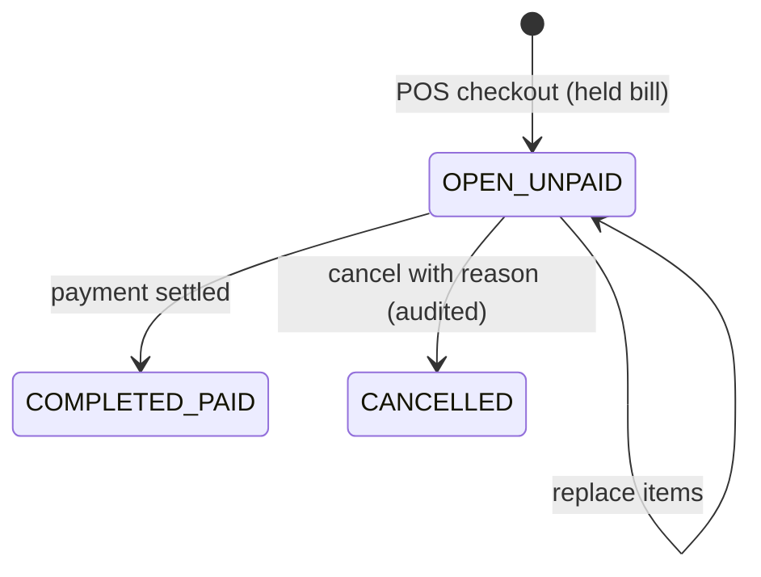
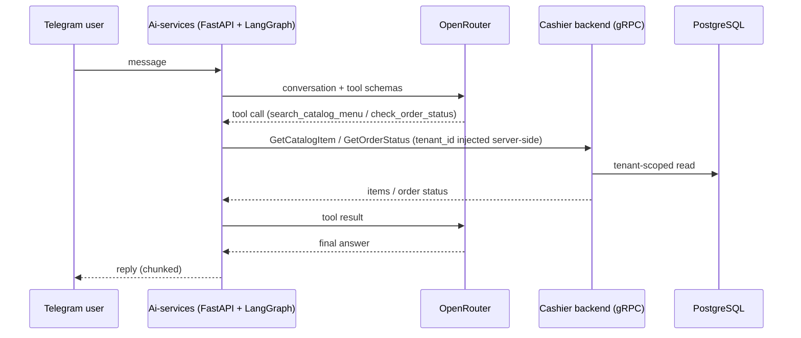

# Architecture

Backend architecture of Cashier SaaS. All paths are relative to `src/main/java/org/lite/project/cashiersaas` unless noted. See the [README](../README.md) for the summary.

## 1. Module boundaries

One deployable Spring Boot application (modular monolith). Layering is by top-level package; there are no per-feature root packages.

| Package | Responsibility |
|---|---|
| `controller` | HTTP adapters. Return `ApiResponse<T>`; errors are mapped centrally by `GlobalExceptionHandler`. |
| `service` | Use cases and transaction boundaries. Identity/sessions (`LoginService`, `RegisterService`, `AuthSessionService`), merchant foundation (`FreeTierOnboardingService`, `CashierInvitationService`, `OutletService`), F&B operations (`Fnb*Service`, `MockFnbGatewayService`), settings and audit (`MerchantBusinessSettingsService`, `MerchantAuditService`). |
| `service/MerchantAccessGuard` | Reusable tenant/outlet authorization policy; resolves a `MerchantAccessContext` from the principal. |
| `repository` | Persistence via `EntityManager`, Blaze-Persistence and QueryDSL typed paths. |
| `entity` | `fnb` (orders, items, payments, discounts, gateway attempts), `shared` (identity, merchant, catalog, audit, billing...), `laundry`. Entities own named transitions (e.g. `SalesOrderEntity`). |
| `dto` | Named request/response classes and explicit mappers; entities are never returned by controllers. |
| `component`, `configuration` | JWT/principal infrastructure, rate limiting; security, JWT, OpenAPI wiring. |
| `grpc` | gRPC service plus catalog/order handlers and mappers. |

Dependency direction: controller -> service -> (guard, repository, mapper).

The F&B module is the active MVP. Laundry and the older generic "cashier sale/catalog" entities exist in the codebase but are not part of the F&B flow described here. The shared `entity.shared.inventory` entities (item, balance, movement, plus the F&B-specific recipe line) are used by F&B for ingredient stock: see "Inventory and recipes" in section 4 (`FnbInventoryController`, `FnbInventoryService`, `FnbStockService`).

## 2. Security model

### Roles

Exactly three: `SUPERADMIN`, `OWNERMERCHANT`, `CASHIER` (`enums/Role`). URL policy (`configuration/SecurityConfiguration`):

| Path prefix | Requirement |
|---|---|
| `/api/v1/auth/login`, `/register`, `/refresh`, `/logout`, `GET /auth/csrf` | anonymous |
| `/api/v1/auth/select-merchant`, `/auth/outlets`, `/api/v1/onboarding/**` | authority `SCOPE_ACCOUNT` |
| Swagger (`/swagger-ui.html`, `/swagger-ui/**`, `/v3/api-docs/**`) | anonymous |
| `/api/v1/merchant/**` | `OWNERMERCHANT` |
| `/api/v1/cashier/**` | `OWNERMERCHANT` or `CASHIER` |
| `/api/v1/platform/**` | `SUPERADMIN` (the rule exists; no controller under this prefix was found in source) |

### Token scopes

- **ACCOUNT scope** - issued after login/registration. Identifies a user only; allows onboarding and choosing a merchant/outlet.
- **MERCHANT scope** - issued after `select-merchant` (and by refresh for an existing session). Carries user, session, tenant, outlet and membership claims plus roles. `TenantJwtAuthenticationConverter` requires these claims and produces a `TenantPrincipal`.

JWTs are HS256 with a mandatory Base64 secret (`CASHIER_JWT_SECRET_B64`, at least 32 bytes), validated issuer/audience/expiry (`configuration/JwtConfiguration`, `component/AudienceValidator`). Access TTL is 15 minutes; refresh TTL 7 days.

### Tenant isolation

Services receive a `TenantPrincipal`; tenant and outlet are never read from a request body. `MerchantAccessGuard.requireOutlet` reloads membership and outlet access from the database. Repositories filter on tenant (and outlet) ids. A missing or foreign record raises `ResourceNotFoundException` (404), so a caller cannot distinguish "not yours" from "does not exist".

### Sessions

`AuthSessionService` stores sessions and refresh-token digests (SHA-256). `refresh` locks the session row, requires an unused, unexpired token, consumes it and issues a replacement; a replayed token revokes the session. The refresh cookie is `HttpOnly`, `SameSite=Strict`, path `/api/v1/auth`; refresh and logout require a CSRF token (`/auth/csrf`).

### CORS and rate limiting

Allowed browser origins come from `app.cors.allowed-origins` (env `CASHIER_CORS_ALLOWED_ORIGINS`, default `http://localhost:5173,http://127.0.0.1:5173`); `SecurityConfiguration` validates each entry at startup (explicit http/https origin, no `*`, path, query or user info) and refuses to start otherwise. The in-memory rate limiter (`RateLimitFilter`) has three groups: `AUTH`, `AUTHENTICATED` and `ANONYMOUS_OTHER` (`CASHIER_RATE_LIMIT_*`).

## 3. Order lifecycle

`OrderStatus` = OPEN, COMPLETED, CANCELLED. `PaymentStatus` = UNPAID, PAID, REFUNDED. `PaymentMethod` = CASH, MANUAL_NON_CASH, MOCK_GATEWAY. A held bill is an `OPEN`/`UNPAID` order. Discount, cancellation and item replacement are only allowed while the order is OPEN/UNPAID. Settlement moves it to COMPLETED/PAID in one step; there is no preparation stage. `SalesOrderEntity` validates transitions. V6 mapped pre-pivot rows (paid -> COMPLETED, unpaid -> OPEN).

## 4. Request flows

### Checkout (POS)

`POST /api/v1/cashier/outlets/{outletId}/fnb/orders` with `Idempotency-Key` (`FnbPosOrderService.checkout`), in one transaction:

1. `guard.requireOutlet` - resolve tenant/outlet from the principal.
2. Validate key format (16-128 chars `[A-Za-z0-9_-]`) and compute the SHA-256 request fingerprint.
3. `orders.lockTenant` (`PESSIMISTIC_WRITE` on the tenant row), then re-run the guard and check tenant/outlet are active and F&B-enabled.
4. Look up an existing order by (tenant, key). If found: same source/outlet/fingerprint replays the stored order, otherwise `409`.
5. Price server-side (`FnbOrderPricingService`): availability re-checked, `BigDecimal` subtotal, tax and service charge from tenant rates.
6. Persist `SalesOrderEntity` (OPEN/UNPAID) with item and option snapshots.

### Replace items of a held bill

`PUT /api/v1/cashier/outlets/{outletId}/fnb/orders/{orderId}/items` (`FnbPosOrderService.replaceItems`), no `Idempotency-Key` (a full replacement is idempotent). Body is the same as checkout. In one transaction: guard, tenant lock, reload the order within tenant/outlet (missing or foreign -> 404), then reject with `409` unless it is an OPEN/UNPAID POS order without a pending gateway attempt or discount. The server re-prices the new lines with the order's snapshot tax and service-charge rates, replaces the lines and writes an audit entry (`FNB_ORDER_ITEMS_REPLACED`). Cancel a held bill with `POST .../{orderId}/cancel`; list held bills with `GET .../fnb/orders?status=OPEN&paymentStatus=UNPAID`.

### Payment

`POST /api/v1/cashier/outlets/{outletId}/fnb/orders/{orderId}/payments` (`FnbPaymentService`): lock tenant, load the order within tenant/outlet, reject if already paid (conflict), and honor a payment idempotency/fingerprint check (a reused key is a conflict; replay returns the prior result). CASH and MANUAL_NON_CASH settle directly; MOCK_GATEWAY creates a gateway attempt (`FnbGatewayAttemptEntity`) that is later resolved with `POST .../mock-payments/{attemptId}/resolve` (`MockFnbGatewayService`, outcomes in `FnbGatewayOutcome`). Settlement sets the order COMPLETED/PAID, records the payment, deducts ingredient stock (see "Inventory and recipes") and writes an audit entry in the same transaction.

### Reporting

`FnbSalesReportService`/`FnbSalesReportRepository` (owner only, `/merchant/outlets/{outletId}/fnb/reports/sales`, CSV at `/csv`) read paid, non-cancelled orders, scoped by tenant/outlet.

### Inventory and recipes

Ingredient stock for F&B (`FnbInventoryService`, `FnbStockService`, `FnbInventoryRepository`; entities in `entity/shared/inventory`).

**Data model** (tables `inventory_*` from V1, `recipe_lines` and constraints from V4):

| Table | Notes |
|---|---|
| `inventory_items` | Per outlet: name (unique per outlet), optional sku, one `unit`, `reorder_level`, `active`. The unit cannot change once the item has movements; there is no unit conversion. |
| `inventory_balances` | One row per (tenant, outlet, item), `quantity_on_hand numeric(14,3)`, versioned. There is deliberately no check constraint, so stock can go negative. |
| `inventory_movements` | Append-only ledger: signed `quantity_delta`, `movement_type` (`RESTOCK`, `WASTE`, `ADJUSTMENT`, `SALE`, restricted by a V4 check), required `reason`, `idempotency_key` (unique per tenant), `request_fingerprint`, `actor_membership_id`, optional `order_id`. A `reversal_of_movement_id` column exists but no code path uses it. |
| `recipe_lines` | A line belongs to exactly one product **or** one product option (add-on), consumes one ingredient, quantity per unit greater than zero, unique per (owner, ingredient). Replacing a recipe is replace-all and is audited (`FNB_RECIPE_CHANGED`). |

**Ledger invariant**: `quantity_on_hand == SUM(quantity_delta)` per item. It is maintained by code, not by a database constraint: every `balance.apply(delta)` is paired with a persisted movement in the same transaction (initial stock in `createItem`, `recordMovement`, `consumeForPaidOrder`). The concurrency integration suite asserts the equality after parallel load.

**Manual movements** (`POST .../inventory/items/{id}/movements`): RESTOCK takes a positive quantity (reason defaults to "Restock"), WASTE takes a positive quantity and stores a negative delta (reason required), ADJUSTMENT takes a signed non-zero quantity (reason required), SALE is rejected because only the system writes it. `ADJUSTMENT`, ingredient create/update/deactivate and recipes require `guard.requireOwner`; RESTOCK/WASTE and the read endpoints only need outlet access (so CASHIER may use them under `/cashier/**`). A movement is replayed when the (tenant, key) already exists with the same fingerprint (`type|item|delta|reason`), and is a `409` when the fingerprint differs. The initial stock written by `createItem` uses key `init:{itemId}`.

**Deduct on paid** (`FnbStockService.consumeForPaidOrder`): called from both settle paths (`FnbPaymentService.settle`, `MockFnbGatewayService.settle`) inside the payment transaction, after the payment row is flushed and before the audit entry:

1. Load the order lines and chosen options, then the recipes of the ordered products and of the chosen options.
2. Sum the need per ingredient: product recipe quantity x line quantity, plus option recipe quantity x the quantity of the line the option belongs to.
3. Lock order: `orders.lockTenant` (taken by the payment code before it gets here), then each ingredient's balance row (`PESSIMISTIC_WRITE` refresh) in ascending ingredient id (the needs are held in a `TreeMap`). Manual movements lock only their single balance row.
4. For each ingredient, skip it if key `sale:{orderId}:{inventoryItemId}` already exists, otherwise apply the negative delta and persist one `SALE` movement (reason "Penjualan {orderNumber}", actor = the paying membership).
5. Return one warning string per ingredient whose resulting status is not `OK` (`NEGATIVE` -> "minus", `OUT` -> "habis", `LOW` -> "menipis"); `FnbPaymentResponse.stockWarnings` carries them.

Status is derived in `InventoryBalanceEntity.status()`: below zero is `NEGATIVE`, exactly zero is `OUT`, at or below `reorder_level` is `LOW`, otherwise `OK`. The method never throws for stock reasons, so stock never blocks a payment. Stock is deducted only when an order becomes paid; a paid order cannot be cancelled (`SalesOrderEntity.cancel` requires OPEN/UNPAID), so there is no stock reversal. A product or option without a recipe produces no movement.

Limits: a parallel same-key manual movement can answer `409` to the loser instead of a replay (the balance still changes once); deactivating an ingredient hides it from the list and from new recipes but existing recipe lines keep deducting it.

### Reusable option groups

Option groups are an outlet-level library (`option_groups`, with an `archived` flag) attached to products through the join table `product_option_groups` (unique per product and group, with `display_order`; V5). V5 backfilled one link per existing group from its old `product_id` and then dropped that column, and the old product-scoped group routes were replaced rather than kept.

- **Rules live on the group** (`required`, `minimum_selections`, `maximum_selections`), not on the link; `validateGroup` rejects inconsistent combinations.
- **Attach** is `PUT /merchant/outlets/{o}/fnb/products/{p}/option-groups` with an ordered `groupIds` list; it deletes the product's links and recreates them in request order (replace-all), rejecting duplicates. It writes no audit row. Option and option-recipe routes are under `.../option-groups/{groupId}/options/...`, and options belong to the group, so a recipe on a shared option applies to every product that has the group.
- **Archive, never delete**: order lines keep `option_group_id` as a snapshot reference. `archiveGroup` returns `409` while any non-archived product is linked; archived groups drop out of the group lists and out of pricing. `archiveGroup` takes no lock (a known limit), and the group response does not list the products it is attached to.
- **Pricing and selection validation** (`FnbOrderPricingService.selectedOptions`) iterate the groups attached to the ordered product (`catalog.groups`, non-archived, in link order), lock each group and its selected options, require the selected count to be within min/max, and reject any selected option that does not belong to those groups. The same shared option can therefore be ordered under any product it is attached to, and an option of an unattached group is rejected.

## 5. Order list refresh (polling)

There is no WebSocket or other server push (removed in the cashier-first pivot). The UI polls the order list over REST every 15 seconds, refetches on window focus and after its own mutations. The PRD target of an order being visible within 5 seconds is therefore not guaranteed.

## 6. AI service integration (gRPC)

Contract: `src/main/proto/cashier_service.proto`, package `cashier.v1`, server on port `CASHIER_GRPC_PORT` (default 9090).

| RPC | Request | Response |
|---|---|---|
| `GetCatalogItem` | `tenant_id`, `query`, `limit` | `tenant_id`, repeated `CatalogItem` (id, name, price as int64, is_available, category) |
| `GetOrderStatus` | `tenant_id`, `order_number` | `tenant_id`, `order_number`, `status`, `payment_status`, `total_amount`, `created_at` |

Server side: `grpc/service/CashierGrpcService` delegates to `CashierCatalogGrpcHandler` and `CashierOrderGrpcHandler`. On the Python side (`Ai-services/`), a tool adapter hides `tenant_id` from the LLM schema and injects it from server-side context; conversations are stored in a separate database (`cashier_ai`) with its own Alembic migrations. The AI service is read-only against the backend (two lookup RPCs); it cannot create or modify orders.

Access control: callers must send `x-internal-service-key` equal to `CASHIER_GRPC_SERVICE_KEY`. The request `tenant_id` is then checked against the database: a tenant is served only when it exists and is active (the earlier environment-variable tenant allowlist was removed). A missing and an inactive tenant return the same status, so the response does not reveal whether a tenant exists. Caveat: `tenant_id` is still supplied by the caller, not bound to a token. The demo compose file does not publish 9090 to the host (internal network only), but keep the gRPC port private until token-bound tenant identity is added.

## 8. Staff sync and Telegram identity (in progress)

Status: under development and not yet verified end to end. Contract: `docs/contracts/member-sync.md`.

- **Registration** requires a phone number, stored normalized (digits with country code, e.g. `6281234567890`). Normalization rules are shared by Java `PhoneNumberNormalizer` and Python `normalize_phone`.
- **Push sync** (Java `MemberSyncClient`, after commit): owner profile completion and cashier invitation claim send `PUT /api/v1/internal/tenants/{tenantId}/members/{userId}` to Ai-services with tenant name, full name, normalized phone, role and status, authenticated by `X-Internal-Service-Key` (`AI_INTERNAL_API_KEY`). Retries are bounded; failures are logged without phone numbers or keys and never fail the business transaction. Disabled when `AI_SERVICE_BASE_URL` is blank.
- **Verification in Telegram**: the Python service identifies a staff member only from a Telegram contact shared by the sender (`contact.user_id` must match the sender). The phone is matched against ACTIVE `tenant_members`; typed numbers are ignored. Zero matches are rejected, one match creates a verified membership, several matches let the user choose a tenant.
- **Tenant per message**: a verified user's tenant and role are resolved from the verified membership on every message, and a disabled member loses access. The tenant flows through graph state into `tool.execute(tenant_id=...)`; tool schemas are unchanged.
- **Development fallback**: `AI_TENANT_ID` is optional and only used for unverified or local use. It never overrides a verified tenant.

## 7. Persistence

PostgreSQL 17+ (V1 uses `SET transaction_timeout`; PostgreSQL 16 rejects it) with Flyway migrations in `src/main/resources/db/migration` (`V1__initial_schema.sql`, `V2__drop_legacy_cashier_tables.sql`, `V3__staff_user_phone_number.sql`, `V4__fnb_inventory_recipe.sql`, `V5__reusable_option_groups.sql`, `V6__order_status_open_completed_cancelled.sql`). V4 adds `recipe_lines`, the movement-type check, the item-history and order indexes on `inventory_movements`, and the per-outlet unique ingredient name; V5 adds `option_groups.archived` and the `product_option_groups` join table, backfills it from the old `option_groups.product_id`, and drops that column; V6 relaxes then tightens `sales_orders_status_check` to `OPEN`/`COMPLETED`/`CANCELLED` and maps old rows. The dining-table and QR tables and columns remain in the schema but are no longer mapped by entities. The demo profile additionally loads `db/demo/R__demo_seed.sql` (a repeatable migration). Hibernate runs with `ddl-auto=validate`; Liquibase is disabled at runtime (a Maven profile exists for schema-diff tooling only). `spring.jpa.open-in-view` is currently `true` in `application.properties`. Money is `BigDecimal`; order lines and options keep price/name snapshots.
