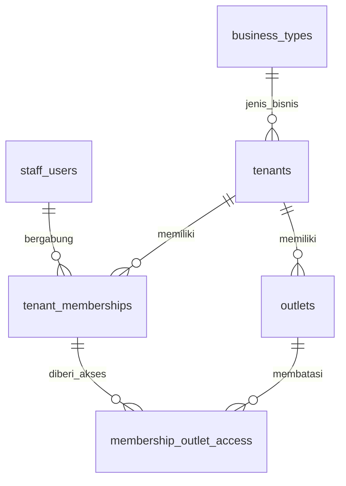
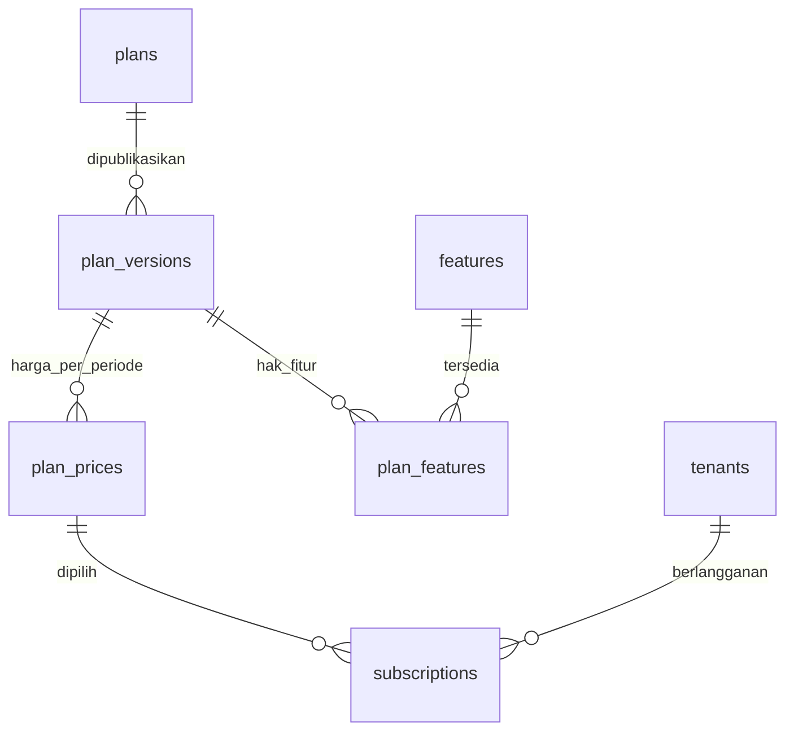
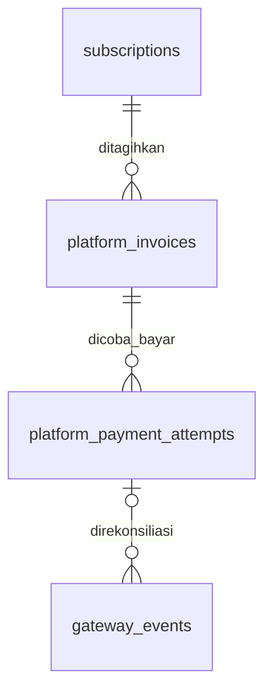
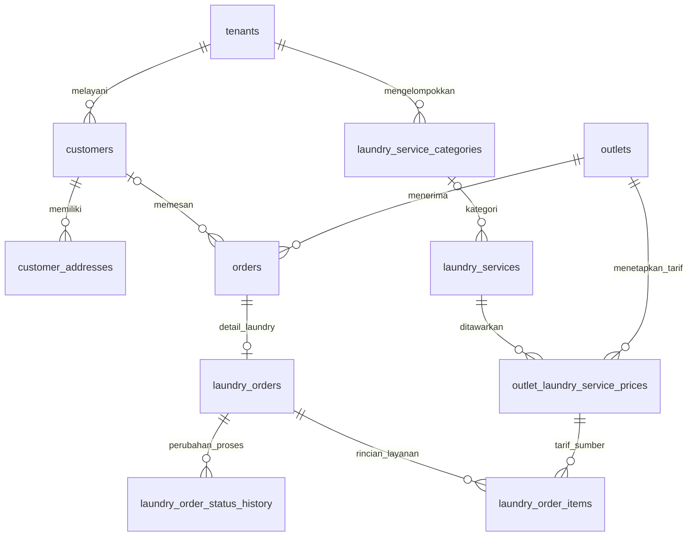
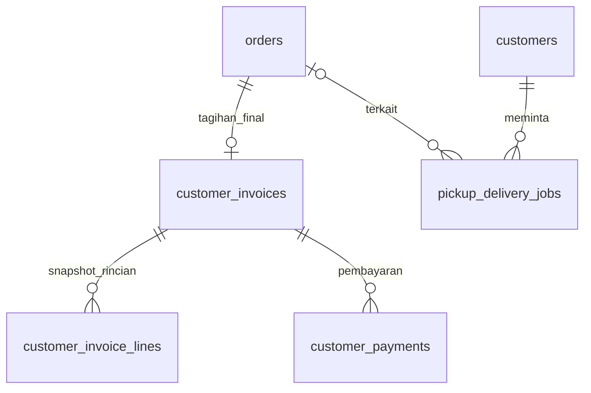
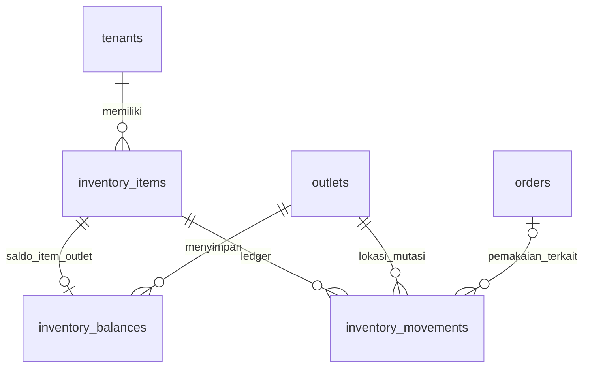
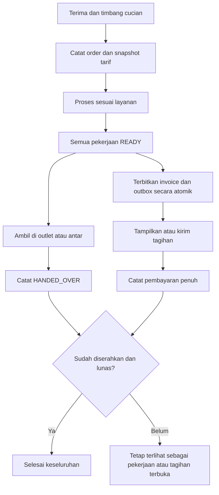

# ERD Laundry v1

Diagram ini memperlihatkan relasi utama dari [SQL referensi](laundry-v1.sql). Setiap `tenants` adalah merchant. Relasi composite tenant/outlet, aktor, dan kolom audit tidak semuanya digambar agar diagram tetap terbaca; constraint lengkap ada di SQL.

## 1. Identitas dan merchant

Satu user boleh memiliki beberapa membership. Satu membership memiliki satu role Owner (`OWNERMERCHANT`) atau Cashier (`CASHIER`). Minimal satu owner aktif per tenant merupakan invariant service, bukan konsekuensi dari diagram FK. Tenant provisional dapat belum memiliki outlet/profil lengkap.

## 2. Penawaran paket dan langganan

Riwayat langganan dapat lebih dari satu, tetapi subscription current dibatasi sesuai constraint dan kebijakan billing. Paket/fitur versi yang sudah dipublikasikan tidak diubah untuk transaksi historis.

## 3. Owner membayar platform

Gateway dapat mengirim event duplikat atau datang sebelum referensi attempt berhasil dicocokkan. Identitas provider/account/event menjaga deduplikasi, sedangkan verifikasi dan rekonsiliasi tetap dilakukan server. Banyak attempt bukan izin mengaktifkan langganan berkali-kali.

## 4. Pelanggan, layanan, dan pesanan laundry

Pada alur penerimaan yang berhasil, header order harus mempunyai satu detail laundry dan setidaknya satu item. FK hanya menjamin child menunjuk parent yang valid; service membuat semuanya dalam satu transaksi. Tarif dan jumlah yang digunakan disalin ke item. Perubahan master harga tidak mengubah order lama.

## 5. Tagihan pelanggan dan penyerahan

PICKUP boleh belum terhubung ke order. DELIVERY harus terhubung ke order yang sudah siap. Rilis pertama menerima satu pembayaran penuh yang berhasil per invoice; relasi fisik bukan aktivasi fitur cicilan. Invoice dan outbox tagihan siap dibuat atomik ketika order READY, tanpa menunggu penyerahan. Outbox mereferensikan agregat secara logis melalui event; tautannya bukan FK invoice sehingga tidak digambar sebagai relasi fisik.

## 6. Persediaan

Katalog item persediaan rilis pertama dimiliki per outlet; satu item tersebut memiliki maksimal satu baris saldo. Ledger merupakan sumber histori. Saldo diperbarui bersama mutasi di bawah lock dan dapat direkonsiliasi terhadap jumlah mutasi. Tidak ada foreign key umum `source_type/source_id` untuk hubungan order; tautannya konkret. `audit_logs` merekam tindakan lintas modul dan sengaja tidak digambar ke setiap tabel.

## 7. Peristiwa utama operasional

Diagram alur adalah kontrak use case yang akan diimplementasikan. SQL referensi belum mengirim notifikasi, menjalankan gateway, atau memvalidasi seluruh transisi lintas tabel.
