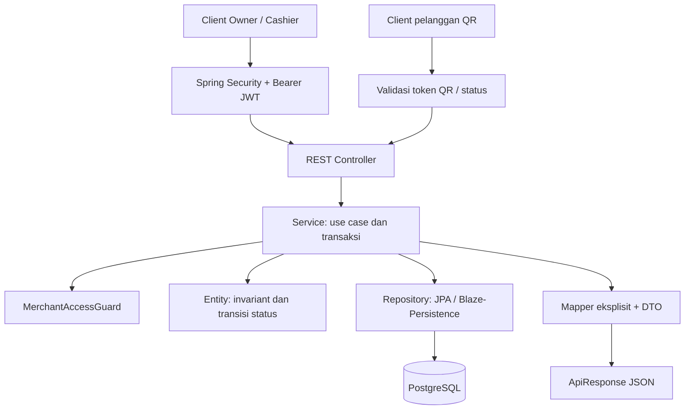

# Laporan arsitektur dan status MVP Cashier SaaS

Tanggal review: 7 Oktober 2026, Asia/Jakarta. Baseline canonical memory: versi 3.
Permintaan: jelaskan arsitektur dan laporkan fitur MVP yang sudah selesai.

## Kesimpulan

Project memiliki satu backend Java/Spring Boot untuk SaaS F&B multi-tenant. Implementasi source alur utama sudah tersedia: onboarding -> katalog -> QR/POS -> pembayaran Pay First -> dapur -> completion -> struk/laporan. MVP produk belum selesai atau terverifikasi end-to-end. Tidak ada milestone yang dinyatakan diterima penuh melalui review ini.

Istilah **tersedia di source** berarti controller, service dan model pendukung terlihat dalam working tree. Ini tidak berarti API sudah berhasil dijalankan, migrasi sudah diterapkan, atau seluruh acceptance criterion lulus. Sebagian implementasi masih untracked/dirty. Review mempertahankan semua perubahan tersebut.

## Sumber dan metode

Membaca `.ai/MEMORY.md`, `.ai/TASKS.md`, `.ai/context/INDEX.md`, `.ai/ARCHITECTURE.md`, `PRD-MVP.md`, dokumen F&B, dua review arsitektur terdahulu, konfigurasi, controller, service, entity, repository terpilih dan artefak Surefire yang sudah ada. `.ai/DECISIONS.md` dan `PROJECT_MEMORY.md` tidak tersedia di working tree saat review; penghapusan PROJECT_MEMORY terlihat pada git status.

Ruflo memory_search dan hooks_route digunakan sebagai konteks tambahan. Codebase Memory get_architecture digunakan untuk navigasi, kemudian dicocokkan terhadap source karena index belum mencakup payment/kitchen terbaru. Dua review worker terdahulu memakai source bundle dengan batas akses yang dicatat dalam laporan masing-masing; tidak ada worker baru dieksekusi untuk laporan ini.

Tidak menjalankan build, test, aplikasi, query database atau migrasi. Tidak mengubah kode aplikasi, SQL atau kode test. Kesimpulan ini merupakan review source dengan sampling batas keamanan, bukan audit keamanan menyeluruh.

## Arsitektur sistem

Stack yang dideklarasikan: Java 17, Spring Boot 4.1.1, Spring MVC, Spring Security, PostgreSQL, Hibernate/JPA, Blaze-Persistence dan QueryDSL. Lombok dipakai pada DTO; Springdoc menyediakan kontrak OpenAPI/Swagger.

Sistem berupa monolit dengan kelompok fungsi identity, merchant, F&B dan reporting. Struktur fisik memakai package top-level controller/service/repository/dto/entity/component/configuration/shared. Ini bukan bukti adanya modul deployment terpisah atau batas modul yang dipaksakan.



Controller mengadaptasi HTTP dan mengembalikan ApiResponse. Service mengelola transaksi dan aturan use case. Entity membatasi transisi bisnis. Repository melakukan akses data tenant/outlet. Mapper membentuk DTO tanpa mengekspos entity langsung. GlobalExceptionHandler memetakan error API.

### Identitas dan akses

- Register/login memakai password BCrypt dan JWT. ACCOUNT scope dipakai sebelum pemilihan merchant; MERCHANT scope membawa konteks tenant/outlet/membership/role.
- Role aktif tepat SUPERADMIN, OWNERMERCHANT, CASHIER. Manager/Kitchen yang masih disebut dalam bagian lama PRD tidak menjadi role aktif. Owner/Cashier mengoperasikan endpoint dapur.
- HTTP stateless; refresh session tetap disimpan di database dengan digest token, rotasi dan revokasi. Secret JWT wajib dari CASHIER_JWT_SECRET_B64.
- MerchantAccessGuard memeriksa akses outlet/membership; repository operasional menggunakan tenant/outlet. Public QR memperoleh konteks server dari token tervalidasi.
- Review terdahulu mengidentifikasi pertanyaan lanjutan mengenai revokasi access JWT sebelum expiry, pengikatan membership_id di guard dan kebijakan FREETIER-only. Belum ada pembuktian isolasi tenant end-to-end dalam review ini.

### Alur F&B aktif

```text
QR / POS checkout -> NEW + UNPAID
Pembayaran berhasil -> CONFIRMED + PAID
Dapur -> PREPARING -> READY -> COMPLETED
NEW + UNPAID -> CANCELLED, wajib alasan dan audit
```

Kedua sumber memakai SalesOrderEntity dan FnbOrderPricingService yang sama. Harga dihitung server menggunakan BigDecimal; nama/harga produk dan opsi disimpan sebagai snapshot, termasuk tarif pajak/service. Checkout menggunakan idempotency key dan fingerprint. Pembayaran menggunakan key/fingerprint tersendiri. Operasi mutasi memakai lock tenant; konsistensi ini berpotensi membatasi throughput lintas outlet dalam tenant yang sama dan belum diuji konkurensinya.

## Fitur yang tersedia di source

| Area | Implementasi yang ditemukan | Bukti utama |
|---|---|---|
| Autentikasi | Register, login, refresh, logout, pilih merchant/outlet | AuthController, RegisterService, LoginService, AuthSessionService |
| Fondasi tenant | Onboarding FNB FREETIER, profil bisnis awal, outlet awal, owner membership, undangan/claim cashier | FreeTierOnboardingService, CashierInvitationService |
| Katalog | Kategori/produk create-update-archive, display order, deskripsi/image URL, availability, grup opsi dan penambahan harga | FnbCatalogController/Service |
| Meja dan QR | Buat/ubah meja, status aktif, QR meja, QR outlet tanpa meja, rotasi token, menu publik | FnbTableService, FnbOrderQrService, PublicQrAccessService |
| Order pelanggan | Checkout tanpa login, item/opsi/jumlah/catatan/label pelanggan, nomor order, token status, idempotency | PublicOrderController/Service |
| POS dan antrean bersama | DINE_IN/TAKEAWAY, meja opsional untuk dine-in, kalkulasi bersama, daftar/detail QR+POS dengan filter/pagination | FnbPosOrderService, FnbStaffOrderController/Service |
| Pembayaran | CASH dengan uang kembali, MANUAL_NON_CASH, settlement atomik ke CONFIRMED/PAID, receipt number, audit, idempotency | FnbPaymentService, PaymentEntity |
| Gateway mock | Attempt PENDING, resolve SUCCEEDED/FAILED, retry terminal dan konflik key | MockFnbGatewayService, FnbGatewayAttemptEntity |
| Diskon | Owner-only, nominal/persentase, NEW/UNPAID, alasan/audit, penghitungan ulang pajak/service dari snapshot | FnbDiscountService, SalesOrderEntity |
| Pembatalan | Owner/Cashier, hanya NEW/UNPAID, wajib alasan/audit, larangan pembatalan paid | FnbOrderCancellationService, SalesOrderEntity |
| Dapur | Antrean paid CONFIRMED/PREPARING/READY, item/opsi/catatan, prepare/ready/complete, audit | FnbKitchenService/Repository |
| Rekonsiliasi meja | AWAITING_PAYMENT jika ada unpaid, ACTIVE jika ada paid aktif, VACANT jika tak ada order aktif | FnbTableReconciliationService |
| Struk | JSON dan HTML dengan CSS cetak, snapshot transaksi, cashier, tender/change, waktu lokal outlet, label mock | FnbReceiptService/Mapper |
| Laporan | Owner-only, ringkasan sales, riwayat transaksi, top products, breakdown metode, tanggal/status/metode, CSV | FnbSalesReportService/Repository |
| Audit pencatatan | Perubahan harga, diskon, pembayaran, pembatalan dan transisi dapur | FnbCatalogService dan service operasional terkait |

Antrean baru staf memuat QR/POS; antrean dapur memuat hanya order yang sudah PAID. Laporan menghitung paid non-cancelled berdasarkan paidAt, tanpa mensyaratkan COMPLETED. Nilai produk terlaris adalah line total sebelum alokasi diskon/pajak/service. CSV dikembalikan sebagai content di dalam JSON agar client menyimpannya. QR API menyediakan token/path; rendering dan download gambar QR belum ditemukan. Foto berupa image URL, bukan bukti fitur upload file.

## Gap terhadap MVP

| Area | Status dan gap |
|---|---|
| Pengaturan bisnis lengkap | Profil awal nama/alamat/telepon/zona waktu tersedia. Field currency/logo/tax/service ada pada entity, tetapi endpoint pengaturan lengkap setelah onboarding belum ditemukan. Kalkulasi pajak/service yang tersedia tidak membuktikan owner sudah bisa mengaturnya. |
| Real-time | REST list/status tersedia untuk polling/resync. Implementasi WebSocket, SimpMessaging, SseEmitter dan TransactionalEventListener tidak ditemukan di main source pada review. Keputusan aktif memilih WebSocket. |
| Frontend | Tidak ditemukan package.json/tsx/vue/html dalam pencarian file repo. Keranjang interaktif, layar POS/dapur/dashboard, rendering QR dan pengalaman cetak browser masih memerlukan client terpisah. |
| Audit viewer | Pencatatan audit tersedia; controller untuk owner membaca audit log belum ditemukan. |
| Migrasi/deployment | V1-V10 lama terhapus di working tree; saat ini hanya V1__initial_schema.sql berupa dump. Dump sudah memuat rate snapshots, payment key dan mock attempts, tetapi kompatibilitas dengan riwayat DB existing belum diverifikasi. |
| Keamanan/runtime | Isolasi tenant, konkurensi checkout/payment, query reporting dan alur penuh belum dibuktikan terhadap database aktual. Rate limiting endpoint publik belum ditemukan dalam source yang diperiksa. |
| Pilot | Tidak ditemukan bukti 3 bisnis pilot, 100 transaksi end-to-end atau pencapaian metrik produk. |

Dokumen docs/fnb-operations.md masih menceritakan konflik V11 dan schema integration pending; workspace sekarang berbeda dan berisi dump V1. Catatan historis itu tidak membuktikan database saat ini masih gagal, maupun bahwa masalah sudah selesai. Penyelesaian histori migrasi perlu evidence baru. Referensi laporan FNB-20261006-orchestrator.md dalam dokumen tersebut tidak tersedia di listing laporan saat review.

Bagian lama PRD tentang bayar setelah makan, meja wajib dan tambahan role sudah digantikan keputusan aktif di bagian atas PRD: F&B prioritas, Pay First, meja opsional, tiga role, frontend terpisah dan gateway mock. Laundry ditunda; keberadaan entity/schema laundry, inventory atau billing bukan bukti fitur MVP aktif sudah selesai.

## Status milestone

| Milestone PRD | Penilaian |
|---|---|
| M1 Fondasi | Sebagian: auth/tenant/onboarding/outlet awal/undangan/audit structure tersedia; pengaturan bisnis penuh dan validasi keamanan belum selesai. |
| M2 Katalog dan Meja | Backend utama tersedia; rendering/download QR dan validasi runtime belum terbukti. |
| M3 Pemesanan | Backend QR/POS/pricing/antrean tersedia; frontend dan push real-time belum tersedia di repo. |
| M4 Operasional dan Pembayaran | Backend payment/kitchen/reconciliation/receipt tersedia; penerapan schema dan alur cetak/transaksi end-to-end belum terverifikasi. |
| M5 Laporan dan Pilot | API laporan/CSV tersedia; dashboard, audit viewer, pengujian tenant dan pilot belum selesai atau belum memiliki bukti. |

AC-02, AC-03, AC-05, AC-06, AC-07 memiliki implementasi source yang relevan. AC-04 memiliki daftar QR/POS bersama dan paid-only kitchen, tetapi push belum ditemukan. AC-01 memiliki guard/scoped queries; belum diterima tanpa pengujian isolasi tenant. Tidak ada AC yang dinyatakan lulus runtime oleh laporan ini.

## Bukti pengujian yang sudah ada

Membaca 11 XML Surefire yang sudah tersimpan di target/surefire-reports: total 52 test, failures 0, errors 0, skipped 0; timestamp file 6 Oktober 2026 15:11:39-40 menurut filesystem. Suite mencakup JWT, onboarding, guard, menu mapper, QR/public order/token, order entity dan cashier sale lama. Ini artefak historis yang belum dikaitkan dengan checksum source saat ini. Tidak membuktikan POS/payment/mock/kitchen/receipt/report terbaru telah diuji end-to-end.

Dokumen fnb-operations mencatat compile berhasil 6 Oktober 18:47 WIB untuk 237 source, tetapi log build yang ditautkan tidak tersedia. Klaim compile tersebut diperlakukan sebagai catatan dokumen, tidak diverifikasi ulang.

## Prioritas berikutnya

1. Tinjau dan tetapkan migrasi untuk database baru dan database existing berdasarkan riwayat aktual, tanpa repair/reset otomatis.
2. Lengkapi pengaturan bisnis owner dan endpoint pembacaan audit.
3. Implementasikan push WebSocket setelah commit dengan REST resync/polling.
4. Saat diminta eksplisit untuk testing, verifikasi alur QR/POS -> bayar -> dapur -> complete -> struk/report, tenant isolation, idempotency dan konkurensi terhadap PostgreSQL.
5. Integrasikan frontend terpisah dan persiapkan pilot setelah acceptance path terverifikasi.

Changed files dalam review: laporan ini serta canonical MEMORY/TASKS/context index untuk menyimpan hasil evidence-qualified. Tidak ada perubahan aplikasi/SQL/test.
